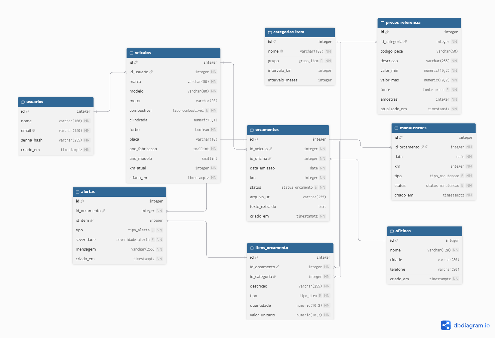

# Revisa

[](https://github.com/JR8705/Revisa/actions/workflows/ci.yml)

Aplicativo para registrar manutenções de veículos e **analisar orçamentos de oficina**: extrai os itens do orçamento, compara preços com o histórico e sinaliza cobranças suspeitas antes de você aprovar o serviço.

> **Status:** em desenvolvimento. A modelagem do banco de dados está concluída; a API tem cadastro de usuário, login com token (JWT), o CRUD de veículos, o registro de orçamentos com itens e total calculado a aprovação ou recusa do orçamento e os alertas automáticos (mão de obra alta, item duplicado, valor zerado, preço acima da referência e troca recente). Cada usuário só enxerga e altera os próprios dados, inclusive os orçamentos, cujo dono vem do veículo. 397 testes automatizados (pytest, inclusive fuzzing com Schemathesis) e verificações de segurança (segredos e dependências) rodam no GitHub Actions a cada push. As manutenções e o upload do orçamento ainda serão criados.

## O problema

Quem não entende de mecânica não tem como saber se um orçamento está caro, se um item é desnecessário ou se aquela peça já foi trocada há pouco tempo. O Revisa usa o histórico do próprio veículo e uma base de preços de referência para responder a essas perguntas.

## Funcionalidades planejadas

- Cadastro de veículos e histórico de manutenções
- Registro de orçamentos, com itens separados em peça e mão de obra
- Extração automática dos itens a partir de foto ou PDF do orçamento
- Comparação de dois ou mais orçamentos lado a lado
- Orçamento aprovado vira registro de manutenção
- Alertas automáticos na análise do orçamento:

| Alerta | Quando dispara |
|---|---|
| `TROCA_RECENTE` | A mesma categoria foi trocada há poucos km ou meses |
| `PRECO_ACIMA_MEDIA` | Valor acima da faixa de referência ou de um orçamento concorrente |
| `MAO_OBRA_ALTA` | Mão de obra desproporcional ao total |
| `ITEM_DUPLICADO` | Mesmo item lançado mais de uma vez |
| `ITEM_GENERICO` | Descrição vaga, sem discriminação do que será feito |
| `CONSUMIVEL_CARO` | Consumíveis (estopa, graxa, etc.) acima do esperado |
| `VALOR_ZERADO` | Item sem valor, que pode virar cobrança depois |

Já funcionam: `MAO_OBRA_ALTA`, `ITEM_DUPLICADO`, `VALOR_ZERADO`, `PRECO_ACIMA_MEDIA` (contra a faixa de referência) e `TROCA_RECENTE` (ver [Alertas do orçamento](#alertas-do-orçamento)). A comparação com orçamento concorrente, `ITEM_GENERICO` e `CONSUMIVEL_CARO` vêm depois.

## Modelo de dados



| Tabela | Função |
|---|---|
| `usuarios` | Donos dos veículos |
| `veiculos` | Veículos de cada usuário |
| `oficinas` | Oficinas que emitem os orçamentos |
| `orcamentos` | Orçamento de uma oficina para um veículo |
| `itens_orcamento` | Cada linha do orçamento (peça ou mão de obra) |
| `categorias_item` | Catálogo que padroniza os itens e guarda os intervalos de troca |
| `precos_referencia` | Faixa de preço (mínimo e máximo) esperada por categoria |
| `alertas` | Avisos gerados na análise de um orçamento |
| `manutencoes` | Serviço realizado a partir de um orçamento aprovado |

### Decisões de modelagem

- **Itens categorizados:** oficinas escrevem o mesmo item de formas diferentes. A tabela `categorias_item` padroniza os itens e permite comparar preços e detectar trocas recentes.
- **Total não armazenado:** o valor do orçamento é calculado pela soma dos itens, o que evita divergência entre o total e os itens.
- **Uma manutenção por orçamento:** a chave estrangeira `manutencoes.id_orcamento` é única.
- **Quilometragem no orçamento e na manutenção:** registra o km no momento do serviço, base dos alertas de troca recente.
- **Preço de referência em faixa:** `precos_referencia` guarda mínimo e máximo, com a origem do dado (manual, histórico ou externo).
- **Motorização padronizada:** em vez de um texto livre como "1.0 Turbo" (que poderia ser escrito "1.0T" ou "1.0 TSI"), o veículo tem `combustivel` (tipo `tipo_combustivel`: FLEX, GASOLINA, ETANOL, DIESEL, ELETRICO, HIBRIDO), `cilindrada` e `turbo`, que permitem comparar veículos e preços. O campo `motor` virou uma descrição complementar opcional. Só o combustível é obrigatório, porque nem todo dono sabe a cilindrada; `turbo` assume `false` quando não informado.
- **Regras no banco:** restrições `CHECK` impedem quilometragem negativa, quantidade zerada, faixa de preço invertida, cilindrada zero ou negativa e cilindrada em veículo elétrico (a regra `ck_veiculos_combustivel_cilindrada`; o híbrido tem cilindrada).

## Tecnologias

| Camada | Tecnologia |
|---|---|
| Banco de dados | PostgreSQL |
| Back-end | Python, FastAPI, SQLAlchemy, Alembic |
| Segurança | argon2 (hash de senha), PyJWT (token), email-validator |
| Qualidade | ruff (lint e formatação), configurado no `pyproject.toml` |
| Testes | pytest e pytest-cov, contra um PostgreSQL real |
| Segurança do pipeline | pre-commit, gitleaks, pip-audit, Schemathesis, regras `S` do ruff, Dependabot (ver [Segurança do pipeline](#segurança-do-pipeline)) |
| Infraestrutura | GitHub Actions (ruff, pytest e verificações de segurança a cada push); Docker planejado |

## Como rodar o banco

Pré-requisito: PostgreSQL 14 ou superior.

```bash
createdb revisa
psql -d revisa -f database/schema.sql
psql -d revisa -f database/seed.sql
psql -d revisa -f database/queries.sql
```

Os arquivos devem ser executados nessa ordem. Também é possível abri-los em um cliente como o DBeaver.

O `queries.sql` traz as consultas usadas para validar o modelo, cada uma com o resultado esperado em comentário.

## Como rodar a API

> Em construção: cadastro, login, CRUD de veículos, orçamentos, itens, aprovação de orçamento e os alertas (itens, preço de referência e troca recente) estão prontos; as manutenções ainda serão criadas.

Pré-requisitos: Python 3.11 ou superior (o CI usa o 3.14) e o banco criado conforme a seção anterior.

```bash
python -m venv .venv
.venv\Scripts\activate          # Windows
source .venv/bin/activate       # Linux e macOS
pip install -r requirements.txt
```

Para desenvolver (ruff, pytest, Schemathesis, pre-commit e as bibliotecas dos testes), use `pip install -r requirements_dev.txt`, que já inclui o `requirements.txt`. Uma vez por clone, instale os ganchos do pre-commit (o gitleaks precisa estar no `PATH`; no Windows: `winget install Gitleaks.Gitleaks`):

```bash
pre-commit install              # ruff e gitleaks passam a rodar sozinhos em cada commit
pre-commit run --all-files      # confere o repositório inteiro uma vez
```

Antes de cada commit:

```bash
pytest
```

Se o ruff corrigir um arquivo, o commit falha na primeira vez: `git add` de novo e repita. Se o gitleaks barrar, o arquivo tem um segredo: tire o segredo, **nunca use `--no-verify`**.

As regras do ruff ficam no `pyproject.toml` (as mesmas que o CI usa). Como rodar os testes: ver [Testes automatizados](#testes-automatizados).

A conexão com o banco e o segredo do token são lidos de variáveis de ambiente, nunca escritos no código. Copie o modelo e preencha:

```bash
cp .env.example .env            # Windows: copy .env.example .env
```

| Variável | O que é |
|---|---|
| `DATABASE_URL` | Endereço do PostgreSQL, com usuário e senha |
| `JWT_SECRET` | Segredo que assina os tokens. Mínimo de 32 caracteres |

Para gerar um `JWT_SECRET` forte:

```bash
python -c "import secrets; print(secrets.token_hex(32))"
```

O `.env` está no `.gitignore`, então senha e segredo não vão para o repositório. Se uma variável estiver faltando (ou o `JWT_SECRET` for curto demais), a API para na inicialização com uma mensagem que cita apenas o nome da variável, sem expor o valor.

Para testar a conexão e subir o servidor:

```bash
python api/database.py          # deve imprimir: Conexão bem-sucedida! O banco respondeu: 1
alembic stamp head              # só na primeira vez: registra a versão do banco (ver abaixo)
uvicorn api.main:app --reload
```

**Usuários do seed:** o `seed.sql` traz usuários de exemplo com um hash de senha **inválido de propósito** (o repositório não publica credenciais). Eles existem para ser donos dos veículos de exemplo, mas **não fazem login**. Para testar a API, cadastre um usuário novo em `POST /usuarios`.

### Migrações do banco (Alembic)

As mudanças na estrutura do banco passam a ser feitas por migrações do Alembic, guardadas em `alembic/versions/` e aplicadas em ordem. O banco é criado pelo `schema.sql` e pelo `seed.sql`; a primeira migração (`162a0455a943`, "base: banco existente") está vazia e representa esse ponto de partida. Em um banco recém-criado pelo `schema.sql`, que já está na estrutura final, o comando é `alembic stamp head`, que apenas registra a versão na tabela `alembic_version`, sem executar nada:

```bash
alembic stamp head              # banco criado pelo schema.sql: registra a versão atual
alembic current                 # mostra a versão atual: 33cb4c40f5a3 (head)
alembic upgrade head            # banco existente: aplica as migrações que faltam
```

| Migração | O que faz |
|---|---|
| `162a0455a943` | Base: representa o banco criado pelo `schema.sql`, sem executar nada |
| `33cb4c40f5a3` | Torna `veiculos.ano_modelo` obrigatório (`NOT NULL`); o `downgrade` volta a aceitar vazio |

O `schema.sql` é mantido igual ao resultado das migrações: um banco criado do zero recebe `stamp head` e já fica na versão mais recente, enquanto um banco existente recebe `upgrade head`. Toda migração é testada antes em uma cópia do banco (`CREATE DATABASE bdrevisa_teste TEMPLATE bdrevisa_pd`), subindo, descendo e subindo de novo.

O `alembic/env.py` lê a conexão da mesma `DATABASE_URL` do `.env` usada pela API, então o `alembic.ini` continua só com o endereço de exemplo e nenhuma senha vai para o repositório.

**Atenção:** o model descreve `usuarios`, `veiculos`, `oficinas`, `categorias_item`, `orcamentos`, `itens_orcamento` e `precos_referencia`, mas ainda não `alertas` e `manutencoes`. Por isso o `alembic revision --autogenerate` hoje propõe apagar essas duas tabelas. Migrações geradas automaticamente precisam sempre ser revisadas antes de rodar.

Com o servidor rodando, a documentação interativa da API fica em `http://127.0.0.1:8000/docs`.

| Rota | Autenticação | Descrição |
|---|---|---|
| `GET /` | não | Verifica se a API está no ar |
| `POST /usuarios` | não | Cadastra um usuário (201) |
| `POST /login` | não | Troca e-mail e senha por um token (200) |
| `GET /veiculos/{veiculo_id}` | **token** | Busca um veículo do usuário logado pelo identificador |
| `GET /veiculos/placa/{veiculo_placa}` | **token** | Busca veículos do usuário logado pela placa (até 10 caracteres; aceita minúsculas e espaços nas pontas) |
| `POST /veiculos` | **token** | Cadastra um veículo para o usuário logado (201) |
| `PATCH /veiculos/{veiculo_id}` | **token** | Altera só os campos enviados (200) |
| `DELETE /veiculos/{veiculo_id}` | **token** | Apaga um veículo (204); 409 se tiver orçamentos |
| `POST /veiculos/{veiculo_id}/orcamentos` | **token** | Registra um orçamento no veículo do usuário logado; nasce `PENDENTE` (201) |
| `GET /veiculos/{veiculo_id}/orcamentos/{orcamento_id}` | **token** | Devolve o orçamento com os itens, o subtotal de cada um e o total (200) |
| `POST /veiculos/{veiculo_id}/orcamentos/{orcamento_id}/itens` | **token** | Acrescenta um item a um orçamento `PENDENTE` (201); 409 se o orçamento não estiver pendente |
| `PATCH /veiculos/{veiculo_id}/orcamentos/{orcamento_id}` | **token** | Aprova ou recusa um orçamento `PENDENTE` (200); 409 se já tiver sido decidido ou se for aprovação sem itens |
| `GET /veiculos/{veiculo_id}/orcamentos/{orcamento_id}/alertas` | **token** | Lista os alertas do orçamento, calculados na hora (200; lista vazia se não houver) |

O token vai no cabeçalho `Authorization: Bearer <token>`. No `/docs`, o botão **Authorize** faz isso.

### Cadastro e login

Fluxo: `POST /usuarios` cria a conta, `POST /login` devolve um token, e as rotas de veículos exigem esse token.

Exemplo de `POST /usuarios`:

```json
{"nome": "Maria Souza", "email": "maria@email.com", "senha": "senhaSegura123"}
```

Resposta (201), sem a senha e sem o hash:

```json
{"id": 9, "nome": "Maria Souza", "email": "maria@email.com"}
```

Exemplo de `POST /login` e a resposta (200):

```json
{"email": "maria@email.com", "senha": "senhaSegura123"}
```

```json
{"access_token": "<token JWT>", "token_type": "bearer"}
```

Respostas observadas:

| Requisição | Status | Resultado |
|---|---|---|
| `POST /usuarios` válido | 201 | usuário criado; e-mail gravado em minúsculas e sem espaços nas pontas |
| `POST /usuarios` com e-mail já cadastrado | 409 | `E-mail já cadastrado.` |
| `POST /usuarios` com senha de 7 caracteres, e-mail inválido ou campo extra | 422 | erro de validação |
| `POST /login` correto | 200 | token |
| `POST /login` com e-mail em maiúsculas | 200 | o e-mail é normalizado igual ao cadastro |
| `POST /login` com senha errada | 401 | `E-mail ou senha incorretos.` |
| `POST /login` com e-mail inexistente | 401 | **a mesma** resposta, com o mesmo status e a mesma mensagem |
| `POST /login` com senha de 129 caracteres ou campo extra | 422 | erro de validação |
| Rota de veículo sem token | 401 | `Not authenticated` |
| Rota de veículo com token inválido, adulterado ou expirado | 401 | `Token inválido.` |
| Veículo de outro usuário (leitura, alteração ou exclusão) | 404 | `Veículo não encontrado.`, idêntico ao de um veículo que não existe |

Decisões:

- **Senha nunca é guardada:** o banco guarda só o hash **argon2id** (com salt, lento de propósito). A resposta nunca devolve a senha nem o hash. `argon2.verify` levanta exceção quando a senha não confere; ela é tratada e vira `False`.
- **Mensagem única no login:** e-mail inexistente e senha errada devolvem o mesmo 401 com a mesma mensagem, para o atacante não descobrir quais e-mails existem.
- **Tempo igual nos dois casos:** com e-mail inexistente, a API confere a senha contra um hash falso (argon2 de verdade, gerado uma vez na inicialização), então a resposta leva o mesmo tempo. Medido: 0,063 s com senha errada contra 0,060 s com e-mail inexistente.
- **Cadastro revela e-mail repetido (409):** decisão de produto, porque o usuário precisa saber que já tem conta. O custo é que um atacante pode testar quais e-mails existem pelo cadastro; a mitigação (limite de tentativas) está nas limitações.
- **POST para o login:** as credenciais vão no corpo, e não na URL, que fica registrada em logs.
- **Token JWT (HS256, 30 minutos):** o `sub` é o id do usuário em texto, o `exp` é obrigatório e a leitura só aceita o algoritmo esperado (bloqueia o ataque `alg: none`). O segredo vem do `.env`.
- **Dependência `usuario_atual`:** lê o token, valida, e **consulta o banco** para confirmar que o usuário ainda existe. Se o usuário foi apagado, o token deixa de valer na hora. Token ausente, adulterado, expirado, sem `exp`, com outro segredo, com `sub` que não é número ou de usuário apagado: todos devolvem o mesmo 401.
- **Dono do veículo vem do token:** `id_usuario` não existe mais no corpo (enviá-lo dá 422). Toda consulta de veículo filtra pelo dono **dentro do `WHERE`**, então o veículo alheio simplesmente não existe para quem pergunta. O erro é 404 e não 403, para não confirmar que o veículo existe.

### Como a API acessa o banco

As rotas não escrevem SQL à mão. Cada peça tem um papel:

| Arquivo | Papel |
|---|---|
| `api/database.py` | Cria a conexão (`engine`) a partir da `DATABASE_URL` |
| `api/config.py` | Lê o `JWT_SECRET` do `.env` e valida o tamanho; define algoritmo e expiração do token |
| `api/seguranca.py` | Hash e verificação de senha (argon2) e criação e leitura do token (JWT) |
| `api/enums.py` | Valores aceitos, compartilhados pelo model e pelo schema: `TipoCombustivelEnum`, `GrupoItemEnum`, `StatusOrcamentoEnum` e `TipoItemEnum` |
| `api/regras.py` | Regras de negócio puras, usadas pelo schema e pela rota: `ano_valido`, `combustivel_valido`, `emissao_valida`, `calcular_subtotal`, `calcular_total` e `transicao_valida` |
| `api/models.py` | Models `Usuario`, `Veiculo`, `Oficina`, `CategoriaItem`, `Orcamento` e `ItemOrcamento` (SQLAlchemy): as tabelas descritas em Python, inclusive colunas internas e pessoais |
| `api/schemas.py` | Schemas Pydantic: entrada (`VeiculoCriar`, `VeiculoAtualizar`, `UsuarioCriar`, `LoginEntrada`, `OrcamentoCriar`, `ItemOrcamentoCriar`, `OrcamentoStatusAtualizar`) e resposta (`VeiculoResposta`, `UsuarioResposta`, `TokenResposta`, `OrcamentoResposta`, `OrcamentoDetalheResposta`, `ItemOrcamentoResposta`) |
| `api/main.py` | Rotas, a dependência `usuario_atual` e a busca `buscar_orcamento_do_usuario` |

```
banco → model → rota → schema de resposta → JSON
```

O model tem `placa`, `id_usuario` e `senha_hash` porque representa a tabela; o schema de resposta não tem, então esses campos são descartados antes da resposta, mesmo que a consulta os traga.

Segurança das consultas:

- **Validação de entrada:** a placa é limitada a 10 caracteres com `Path(max_length=10)`. Uma entrada maior recebe 422 antes de qualquer acesso ao banco.
- **Parâmetros automáticos:** as consultas são montadas com `select(...).where(...)`, e o SQLAlchemy envia os valores como parâmetros, separados do comando, o que impede SQL Injection.
- **Lista branca na resposta:** o `response_model` só deixa sair os campos do schema. Dados internos (`id_usuario`, `senha_hash`) e pessoais (`placa`) nunca chegam ao cliente.
- **Erros genéricos:** a resposta de erro não revela detalhes do banco; o motivo de uma falha aparece apenas no terminal do servidor.

As camadas são complementares (defesa em profundidade): o limite de tamanho barra entradas absurdas, mas não é a proteção contra SQL Injection. Um ataque curto como `'OR 1=1--` cabe em 10 caracteres e chega ao banco, onde o parâmetro o transforma em uma busca inofensiva (404).

Respostas de `GET /veiculos/{veiculo_id}` (com o token do dono do veículo e os dados do `seed.sql`):

| Requisição | Status | Resposta |
|---|---|---|
| `/veiculos/1` | 200 | `{"id":1,"marca":"Volkswagen","modelo":"Gol","motor":"MPI","combustivel":"FLEX","cilindrada":"1.0","turbo":false,"ano_fabricacao":2018,"ano_modelo":2018,"km_atual":98000}` |
| `/veiculos/7` | 200 | `{"id":7,"marca":"BYD","modelo":"Dolphin","motor":null,"combustivel":"ELETRICO","cilindrada":null,"turbo":false,"ano_fabricacao":2024,"ano_modelo":2024,"km_atual":15000}` |
| `/veiculos/99999` | 404 | `{"detail":"Veículo não encontrado."}` |
| `/veiculos/1` com o token de **outro** usuário | 404 | a mesma resposta acima |
| `/veiculos/abc` | 422 | Erro de validação: o identificador precisa ser um número inteiro |

Respostas de `GET /veiculos/placa/{veiculo_placa}` (com o token do dono):

| Requisição | Status | Resposta |
|---|---|---|
| `/veiculos/placa/QWE1A23` | 200 | `[{"id":1,"marca":"Volkswagen","modelo":"Gol","motor":"MPI","combustivel":"FLEX","cilindrada":"1.0","turbo":false,"ano_fabricacao":2018,"ano_modelo":2018,"km_atual":98000}]` |
| `/veiculos/placa/qwe1a23` | 200 | Mesmo resultado: a placa é normalizada com `strip().upper()` antes da consulta |
| `/veiculos/placa/AAA0000` | 404 | `{"detail":"Veículo não encontrado."}` |
| `/veiculos/placa/AAAAAAAAAAA` | 422 | Erro de validação `string_too_long`: a placa tem no máximo 10 caracteres, igual ao `varchar(10)` do banco |

Como a placa não é única no banco, a rota devolve uma lista.

Sobre os campos da resposta:

- `combustivel` só assume um dos seis valores do enum, que aparecem documentados em `/docs`.
- `cilindrada` vem como texto (`"1.0"`), e não como número. Ela é um `Decimal`, e o JSON transformaria um número em ponto flutuante no cliente, com risco de perder precisão; como texto, o valor chega exato. É `null` em veículos elétricos.

### Cadastro, alteração e exclusão de veículos

Com a escrita, o cliente passa a mandar dados para o banco. Por isso a entrada tem schemas próprios, separados do de resposta:

| Schema | Uso | Regras |
|---|---|---|
| `VeiculoCriar` | corpo do `POST` | todos os campos obrigatórios do banco exigidos; `extra = 'forbid'` |
| `VeiculoAtualizar` | corpo do `PATCH` | todos os campos opcionais (padrão `None`); `extra = 'forbid'` |
| `VeiculoResposta` | resposta das rotas | lista branca: sem `placa`, `id_usuario` e `criado_em` |

Exemplo de `POST /veiculos` (com o cabeçalho `Authorization`):

```json
{"marca": "Fiat", "modelo": "Argo", "motor": "Firefly", "placa": " abc1d23 ",
 "combustivel": "FLEX", "cilindrada": "1.3", "turbo": false,
 "ano_fabricacao": 2021, "ano_modelo": 2022, "km_atual": 30000}
```

Resposta (201), com `id` gerado pelo banco e sem `placa`:

```json
{"id": 9, "marca": "Fiat", "modelo": "Argo", "motor": "Firefly", "combustivel": "FLEX", "cilindrada": "1.3", "turbo": false, "ano_fabricacao": 2021, "ano_modelo": 2022, "km_atual": 30000}
```

Respostas observadas:

| Requisição | Status | Resultado |
|---|---|---|
| `POST` válido | 201 | veículo criado para o usuário logado; placa gravada como `ABC1D23` (`strip().upper()`) |
| `POST` sem token | 401 | `Not authenticated` |
| `POST` com `id`, `id_usuario` ou `criado_em` | 422 | `extra_forbidden` (mass assignment barrado) |
| `POST` com `km_atual: -1` | 422 | `greater_than_equal` |
| `POST` elétrico com cilindrada | 422 | "Veículo elétrico não tem cilindrada." |
| `POST` com `ano_fabricacao 2022` e `ano_modelo 2024` | 422 | o ano do modelo é igual ao de fabricação ou no máximo 1 a mais |
| `PATCH {"km_atual": 105000}` | 200 | só o km muda |
| `PATCH {}` | 200 | nada muda |
| `PATCH {"marca": null}` | 422 | campo obrigatório no banco não aceita `null` |
| `PATCH {"motor": null}` / `{"cilindrada": null}` | 200 | campos opcionais aceitam `null` |
| `PATCH {"combustivel": "ELETRICO"}` em veículo com cilindrada | 422 | "Veículo elétrico não tem cilindrada." |
| `PATCH {"ano_modelo": 2025}` em veículo de 2018 | 422 | regra dos anos checada sobre os valores finais; nada é gravado |
| `PATCH {"id_usuario": 5}` | 422 | o dono não muda por PATCH |
| `PATCH` ou `DELETE` em id inexistente ou de outro usuário | 404 | `Veículo não encontrado.` |
| `DELETE` de veículo sem orçamentos | 204 | apagado; o `GET` seguinte dá 404 |
| `DELETE /veiculos/1` pelo dono (tem orçamentos) | 409 | `Veículo possui orçamentos vinculados. Não é possível apagar o veículo.` |

Decisões:

- **Entrada separada da resposta:** o cliente não escolhe `id`, `id_usuario` nem `criado_em`. O `id_usuario` vem do token.
- **`forbid` na entrada:** campo desconhecido gera erro 422 em vez de ser ignorado em silêncio. O `forbid` só vale onde chega dado de fora; a resposta é montada pelo servidor.
- **`PATCH` com `exclude_unset=True`:** aplica só o que o cliente enviou. O padrão `None` do schema nunca chega ao banco. Campos obrigatórios no banco recusam `null` enviado, mas podem ser omitidos.
- **Regras entre campos em um lugar só:** a regra dos anos e a do elétrico sem cilindrada ficam em `api/regras.py`. O schema (`POST`) e a rota (`PATCH`, sobre os valores finais do veículo, porque o schema só enxerga o corpo) chamam as mesmas funções.
- **Limites espelham as colunas:** além dos mínimos, o schema impõe máximos (`km_atual` até 6.000.000; `cilindrada` com `max_digits=3`, `decimal_places=1`, sem infinito nem `NaN`; textos com o tamanho do `varchar`), para o erro do cliente virar 422 e não 500.
- **Placa normalizada na gravação:** `strip().upper()`, igual à busca. Aceita `null`, e a placa não é única.
- **Erros do banco:** `IntegrityError` no `commit` gera `rollback` e resposta genérica (422 no cadastro e na alteração, 409 na exclusão). O detalhe vai só para o terminal.
- **Exclusão bloqueada com vínculos:** a chave estrangeira não tem `ON DELETE`, então o banco impede apagar veículo com orçamentos. Foi mantido assim de propósito para não destruir histórico.

### Orçamentos e itens

O orçamento não tem `id_usuario`: o dono vem do veículo (`orçamento → veículo → usuário`). Por isso toda consulta de orçamento junta as duas tabelas e confere o dono **dentro do `WHERE`**, com três condições juntas: o id do orçamento, o id do veículo da URL e o dono do veículo.

```
token → id do usuário → o orçamento existe, é do veículo da URL e o veículo é do usuário? → só então lê ou grava
```

| Schema | Uso | Regras |
|---|---|---|
| `OrcamentoCriar` | corpo do `POST` de orçamento | `id_oficina` > 0; `data_emissao` não pode ser futura; `km` de 0 a 6.000.000; `extra = 'forbid'` |
| `ItemOrcamentoCriar` | corpo do `POST` de item | `descricao` de 1 a 255 caracteres (sem espaços nas pontas); `quantidade` > 0; `valor_unitario` ≥ 0; ambos até 10 dígitos com 2 decimais, sem infinito nem `NaN`; `extra = 'forbid'` |
| `OrcamentoStatusAtualizar` | corpo do `PATCH` de orçamento | só `status`, e só `APROVADO` ou `RECUSADO` (`Literal`); `extra = 'forbid'` |
| `OrcamentoResposta` | resposta do `POST` e do `PATCH` de orçamento | lista branca: sem `criado_em`, `arquivo_url` e `texto_extraido` |
| `ItemOrcamentoResposta` | cada item nas respostas | inclui o `subtotal`; sem `id_orcamento` |
| `OrcamentoDetalheResposta` | resposta do `GET` | o orçamento, mais `itens` e `total` |

Exemplo de `POST /veiculos/9/orcamentos` (com o cabeçalho `Authorization`):

```json
{"id_oficina": 1, "data_emissao": "2026-10-20", "km": 31000}
```

Resposta (201): o status nasce `PENDENTE` e não é escolhido pelo cliente.

```json
{"id": 15, "id_veiculo": 9, "id_oficina": 1, "data_emissao": "2026-10-20", "km": 31000, "status": "PENDENTE"}
```

Exemplo de `POST /veiculos/9/orcamentos/15/itens`:

```json
{"id_categoria": 10, "descricao": "Pastilha de freio dianteira", "tipo": "PECA", "quantidade": "2.00", "valor_unitario": "10.50"}
```

Resposta (201), com o subtotal calculado pelo servidor:

```json
{"id": 62, "id_categoria": 10, "descricao": "Pastilha de freio dianteira", "tipo": "PECA", "quantidade": "2.00", "valor_unitario": "10.50", "subtotal": "21.00"}
```

Resposta de `GET /veiculos/1/orcamentos/3` (com o token do dono do veículo e os dados do `seed.sql`; o orçamento tem a bomba d'água lançada duas vezes):

```json
{
  "id": 3, "id_veiculo": 1, "id_oficina": 3, "data_emissao": "2026-09-20", "km": 97900, "status": "RECUSADO",
  "itens": [
    {"id": 10, "id_categoria": 13, "descricao": "Kit correia dentada + tensor", "tipo": "PECA", "quantidade": "1.00", "valor_unitario": "690.00", "subtotal": "690.00"},
    {"id": 11, "id_categoria": 17, "descricao": "Bomba d'água", "tipo": "PECA", "quantidade": "1.00", "valor_unitario": "380.00", "subtotal": "380.00"},
    {"id": 12, "id_categoria": 17, "descricao": "Bomba d'água", "tipo": "PECA", "quantidade": "1.00", "valor_unitario": "380.00", "subtotal": "380.00"},
    {"id": 13, "id_categoria": 29, "descricao": "Material diverso", "tipo": "PECA", "quantidade": "1.00", "valor_unitario": "150.00", "subtotal": "150.00"},
    {"id": 14, "id_categoria": 4, "descricao": "Líquido de arrefecimento (litro)", "tipo": "PECA", "quantidade": "3.00", "valor_unitario": "32.00", "subtotal": "96.00"},
    {"id": 15, "id_categoria": 28, "descricao": "Mão de obra correia e bomba d'água", "tipo": "MAO_OBRA", "quantidade": "1.00", "valor_unitario": "450.00", "subtotal": "450.00"}
  ],
  "total": "2146.00"
}
```

Respostas observadas:

| Requisição | Status | Resultado |
|---|---|---|
| `POST` de orçamento válido | 201 | orçamento criado com `status` `PENDENTE`, sem `criado_em` |
| `POST` de orçamento com `km` menor que o `km_atual` do veículo | 201 | permitido: um orçamento antigo é legítimo |
| `POST` de orçamento sem token | 401 | `Not authenticated` |
| `POST` de orçamento em veículo de outro usuário ou inexistente | 404 | `Veículo não encontrado.`, nada é gravado |
| `POST` de orçamento com `id`, `id_veiculo`, `status` ou `criado_em` | 422 | `extra_forbidden` (mass assignment barrado) |
| `POST` de orçamento com `id_oficina` inexistente | 422 | `Oficina inválida.` |
| `POST` de orçamento com `km` negativo ou enorme, data futura ou data inválida | 422 | erro de validação |
| `GET` do orçamento pelo dono | 200 | orçamento, itens, subtotais e total |
| `GET` sem token | 401 | `Not authenticated` |
| `GET` por outro usuário, com o veículo do dono | 404 | `Orçamento não encontrado.` |
| `GET` por outro usuário, com **o próprio veículo** e o orçamento do dono | 404 | a mesma resposta |
| `GET` pelo dono com um veículo dele que não é o do orçamento | 404 | a mesma resposta |
| `GET` de ids inexistentes | 404 | a mesma resposta, idêntica nos quatro casos |
| `GET` com `orcamento_id` não numérico | 422 | erro de validação |
| `POST` de item válido | 201 | item criado, com `subtotal` |
| `POST` de item em orçamento alheio, com veículo alheio ou que não combina | 404 | `Orçamento não encontrado.`, nada é gravado |
| `POST` de item em orçamento `APROVADO` ou `RECUSADO` | 409 | `Não é possível alterar este orçamento.` |
| `POST` de item com `id_categoria` inexistente | 422 | `Categoria inválida.` |
| `POST` de item com `id`, `id_orcamento` ou `subtotal` | 422 | `extra_forbidden` |
| `POST` de item com `descricao` vazia, só com espaços ou com 256 caracteres | 422 | erro de validação |
| `POST` de item com `quantidade` 0, negativa, `inf` ou `NaN` | 422 | erro de validação |
| `POST` de item com `valor_unitario` negativo ou com 11 dígitos | 422 | erro de validação |
| `POST` de item com `valor_unitario` 0 | 201 | permitido: o banco aceita e o alerta `VALOR_ZERADO` existe para esse caso |

Decisões:

- **Dono pela junção, no `WHERE`:** o orçamento alheio simplesmente não existe para quem pergunta. O erro é 404 e não 403, para não confirmar que ele existe.
- **Os dois ids da URL precisam casar:** um usuário que passa o **próprio** `veiculo_id` com o `orcamento_id` de outro também recebe 404. Checar só o veículo abriria essa brecha.
- **Mesma resposta nos quatro 404:** orçamento alheio, veículo alheio, ids que não combinam e ids inexistentes devolvem o mesmo status e o mesmo corpo.
- **Ids vêm do objeto validado:** `id_veiculo` e `id_orcamento` gravados são os do veículo e do orçamento que a consulta devolveu, nunca o texto da URL e nunca o corpo.
- **Status não é escolhido pelo cliente:** o orçamento nasce `PENDENTE`. Item só entra em orçamento `PENDENTE`, para o total não mudar depois da decisão do dono (409 com conflito de estado).
- **Total e subtotal calculados pelo servidor:** funções puras em `api/regras.py` (`calcular_subtotal`, `calcular_total`), sem acesso ao banco. O cliente não tem como mandar um total. Os valores usam `Decimal` e saem como texto no JSON (`"2146.00"`).
- **Arredondamento por item:** cada subtotal é arredondado para 2 casas e o total é a soma deles (padrão `ROUND_HALF_EVEN` do Python; ver limitações).
- **`km` menor que o do veículo é permitido,** e a data de emissão não pode ser futura (`emissao_valida`).
- **Oficinas e categorias são um catálogo compartilhado,** sem dono. O cliente só escolhe por id. A existência é conferida antes de gravar (422 limpo), e o `IntegrityError` no `commit` continua como rede de segurança.
- **Limites espelham as colunas:** `descricao` até 255, `quantidade` e `valor_unitario` em `numeric(10,2)`, para o erro do cliente virar 422 e não 500.
- **Busca do dono em um lugar só:** a junção e as três condições ficam na função `buscar_orcamento_do_usuario`, usada por todas as rotas de orçamento. Corrigir ou mudar a regra num lugar vale para todas, e uma rota nova não tem como esquecer uma das condições.

### Aprovar ou recusar orçamento

O orçamento nasce `PENDENTE` e o dono decide uma única vez: `APROVADO` ou `RECUSADO`. Os dois são estados finais.

```
PENDENTE ──→ APROVADO   (precisa ter pelo menos um item)
    └──────→ RECUSADO
```

Exemplo de `PATCH /veiculos/9/orcamentos/15` (com o cabeçalho `Authorization`):

```json
{"status": "APROVADO"}
```

Resposta (200):

```json
{"id": 15, "id_veiculo": 9, "id_oficina": 1, "data_emissao": "2026-10-20", "km": 31000, "status": "APROVADO"}
```

Respostas observadas:

| Requisição | Status | Resultado |
|---|---|---|
| Dono aprova orçamento `PENDENTE` com itens | 200 | `status` `APROVADO`, gravado no banco |
| Dono recusa orçamento `PENDENTE`, com ou sem itens | 200 | `status` `RECUSADO` |
| Aprovar o que já está aprovado, ou mudar a decisão (`APROVADO` ↔ `RECUSADO`) | 409 | `Não é possível alterar este orçamento.`; o status não muda |
| Aprovar orçamento sem itens | 409 | a mesma mensagem; continua `PENDENTE` |
| Item novo em orçamento aprovado | 409 | a mesma mensagem |
| `{"status": "PENDENTE"}`, `"PAGO"`, `"aprovado"` (minúsculo) ou `{}` | 422 | erro de validação |
| `id`, `total` ou `id_veiculo` no corpo | 422 | `extra_forbidden` |
| Sem token | 401 | `Not authenticated` |
| Orçamento alheio, veículo alheio, ids que não combinam ou inexistentes | 404 | `Orçamento não encontrado.`, corpo idêntico nos quatro casos; nada muda |

Decisões:

- **Uma rota `PATCH` com o status no corpo,** em vez de `/aprovar` e `/recusar`: um schema e uma rota.
- **O schema documenta a verdade:** o campo usa `Literal[APROVADO, RECUSADO]`, então o `/docs` mostra só as duas opções aceitas e `PENDENTE` dá 422 antes de chegar à rota.
- **Regra de transição pura:** `transicao_valida(atual, novo)` em `api/regras.py` só aceita sair de `PENDENTE`. Ela cobre repetir a decisão e reabrir o orçamento numa função só.
- **404 antes do 409:** a rota primeiro confirma que o orçamento é do usuário. Se a regra de estado viesse antes, um intruso que recebesse 409 num orçamento alheio descobriria que ele existe e até que já foi decidido.
- **Aprovar exige item:** aprovar total zero não faz sentido. A existência é conferida com `limit(1)`, sem carregar os itens.
- **Aprovar não cria a manutenção:** a manutenção terá rota própria.
- **Trava da linha ao decidir:** o `PATCH` de status e o `POST` de item buscam o orçamento com `with_for_update(of=Orcamento)`. Uma segunda requisição sobre o mesmo orçamento espera a primeira gravar e então lê o estado novo (e recebe 409). O `GET` não trava: leitura não espera ninguém. O `of=` limita a trava à linha do orçamento; sem ele, o `join` travaria também a linha do veículo.

### Alertas do orçamento

Os alertas apontam o que merece atenção antes de aprovar. São **calculados a cada consulta**, a partir dos itens atuais do orçamento, e não ficam gravados: enquanto o orçamento está `PENDENTE` os itens mudam, e um alerta gravado ficaria velho.

```
GET .../alertas → buscar_orcamento_do_usuario (dono no WHERE) → montar_itens
               → tetos (precos_referencia) + intervalos (categorias_item) + histórico (aprovados do mesmo veículo)
               → gerar_alertas → lista ordenada
```

A rota só busca os dados. Quem decide são funções puras em `api/alertas.py`, que recebem a lista de itens (a mesma que o `GET` do orçamento mostra, montada por `montar_itens`), os tetos, os intervalos, o histórico, o km e a data do orçamento, e não tocam no banco.

| Alerta | Regra | Severidade | Aponta para |
|---|---|---|---|
| `MAO_OBRA_ALTA` | soma dos itens `MAO_OBRA` (diagnóstico incluído) **maior que** 50% do total (`LIMITE_MAO_OBRA`) | `MEDIA` | o orçamento (`id_item` nulo) |
| `ITEM_DUPLICADO` | mesma descrição depois de `normalizar_descricao`: sem acentos, espaços, pontuação e maiúsculas (`Bomba d'água`, `BOMBA DAGUA` e `bomba-d agua` viram `bombadagua`) | `ALTA` | a **segunda** ocorrência em diante |
| `VALOR_ZERADO` | `valor_unitario` igual a zero | `ALTA` | o item |
| `PRECO_ACIMA_MEDIA` | item `PECA` com `valor_unitario` **maior que** o teto da categoria (maior `valor_max` da fonte `MANUAL`) | `ALTA` se passar de 20% (`LIMITE_PRECO_ALTA`), senão `MEDIA` | o item |
| `TROCA_RECENTE` | item `PECA` cuja categoria foi trocada num orçamento `APROVADO` anterior **do mesmo veículo** e **nenhum** intervalo da categoria (km ou meses completos) foi atingido; vale a troca mais recente (empate de data: a de maior km); categoria sem intervalo é ignorada | `ALTA` | o item |

A lista sai ordenada por severidade (`ALTA`, `MEDIA`, `BAIXA`) e, dentro dela, pelo `id_item`, com o alerta do orçamento inteiro por último.

Resposta de `GET /veiculos/2/orcamentos/5/alertas` (orçamento 5 do seed: óleo e filtro trocados de novo 2.200 km depois do orçamento 4, aprovado, e mão de obra de R$ 350):

```json
[
  {"tipo": "TROCA_RECENTE", "severidade": "ALTA", "id_item": 21, "mensagem": "O item 'Óleo 0W20 sintético (litro)' foi trocado há 2200 km e 1 meses."},
  {"tipo": "TROCA_RECENTE", "severidade": "ALTA", "id_item": 22, "mensagem": "O item 'Filtro de óleo' foi trocado há 2200 km e 1 meses."},
  {"tipo": "MAO_OBRA_ALTA", "severidade": "MEDIA", "id_item": null, "mensagem": "Mão de obra representa 51.09% do total (limite de 50%)."}
]
```

Respostas observadas:

| Requisição | Status | Resultado |
|---|---|---|
| Orçamento 3 do seed (kit correia caro, bomba d'água lançada duas vezes) | 200 | `PRECO_ACIMA_MEDIA` `ALTA` no item 10 (38%), `ITEM_DUPLICADO` no 12, `PRECO_ACIMA_MEDIA` `MEDIA` nos itens 11 e 12 (18,75%) |
| Orçamento 13 do seed (bico diesel a R$ 1.500, teto R$ 1.200) | 200 | `PRECO_ACIMA_MEDIA` `ALTA` (exatamente 25%) |
| Preço igual ao teto, ou categoria sem teto (mão de obra) | 200 | sem alerta de preço |
| Troca anterior `PENDENTE`/`RECUSADA`, com data posterior, de outro veículo do mesmo dono ou de outro usuário | 200 | sem `TROCA_RECENTE` |
| Orçamento sem itens, ou sem nada a apontar | 200 | `[]` |
| Todos os itens com valor zero | 200 | um `VALOR_ZERADO` por item, sem divisão por zero |
| Orçamento já `APROVADO` ou `RECUSADO` | 200 | os alertas continuam (servem de histórico) |
| Sem token ou com token forjado | 401 | — |
| Orçamento alheio, veículo alheio, ids que não combinam ou inexistentes | 404 | `Orçamento não encontrado.`, corpo idêntico |
| Id `0`, `abc`, `1 OR 1=1` ou acima de 2.147.483.647 | 422 | — |
| `POST`, `PUT`, `PATCH` ou `DELETE` na rota | 405 | — |

Decisões:

- **Duplicado pela descrição, não pela categoria:** pela categoria, amortecedor dianteiro e traseiro (trocar os dois é normal) virariam alerta. Preço diferente não esconde a repetição.
- **Limite estrito:** exatamente 50% não alerta.
- **Severidades** seguem o `seed.sql`: cobrança em dobro e item sem valor são `ALTA`; mão de obra alta pode ter explicação (serviço difícil com peça barata) e é `MEDIA`.
- **Teto por preço unitário:** a faixa é por unidade (litro, frasco, jogo); comparar o subtotal faria 4 litros de óleo baratos parecerem caros.
- **Só itens `PECA`** geram preço acima do teto e troca recente: o teto e o intervalo são de peça.
- **Faixas `MANUAL`:** as categorias de peça têm faixa no `seed.sql`, pesquisada no varejo online em 05/11/2026; o teto é o maior preço achado × 1,5 (revenda da oficina) e cada linha traz a fonte. Mão de obra, serviços e consumíveis não têm teto.
- **Sem trava:** a rota só lê. Travar a linha faria a aprovação e a inclusão de itens esperarem cada consulta, sem impedir nenhuma corrida.

Segurança:

- **O dono continua no `WHERE`** (`buscar_orcamento_do_usuario`): o intruso recebe o mesmo 404 de um orçamento inexistente, sem saber se há alertas.
- **Consultas internas também filtram:** o `TROCA_RECENTE` lê orçamentos anteriores, e a consulta filtra pelo veículo do orçamento já validado (`orcamento.id_veiculo`, nunca o id da URL). Sem esse filtro, a troca aprovada de outro usuário apareceria como "anterior" e a mensagem do alerta vazaria o km e a época da manutenção alheia (um IDOR por um caminho lateral). Um teste cria a troca no veículo do intruso e confere que o dono não recebe alerta; a mutação que compara com `Veiculo.id` (coluna com coluna, sem filtrar nada) derruba 21 testes.
- **Tetos não têm dono:** `precos_referencia` é catálogo compartilhado, como oficinas e categorias, e a consulta não filtra por usuário (não é IDOR). O risco futuro é outro: quando o teto vier dos preços lançados pelos usuários (fonte `HISTORICO`), alguém pode lançar preços falsos para mexer nele (envenenamento de dados). Por isso só a fonte `MANUAL` conta hoje.
- **XSS na mensagem:** a mensagem repete a descrição digitada, e na S3 a descrição virá do PDF da oficina. A API devolve JSON e guarda o texto original; quem mostrar a mensagem numa tela precisa escapar o texto na saída (o React faz isso por padrão; o risco é usar `innerHTML` ou `dangerouslySetInnerHTML`), para que um `<script>` gravado na descrição não rode no navegador de quem abre o orçamento (XSS armazenado).

### Testes automatizados

Os testes ficam em `tests/` e usam pytest com o `TestClient` do FastAPI: a API roda dentro do processo do teste e conversa com um PostgreSQL de verdade (nada de banco falso, porque parte do que se testa são regras do próprio banco, como a trava de linha e as chaves estrangeiras).

```bash
pytest                       # tudo (cerca de 1min30)
pytest -m "not lento"        # pula a corrida com threads e a medição de tempo do login
pytest -m "not fuzz"         # pula o fuzzing (Schemathesis e byte nulo)
pytest tests/test_aprovacao.py -v
pytest --cov --cov-report=term-missing   # mostra as linhas da api/ sem teste
```

| Arquivo | O que cobre |
|---|---|
| `test_regras.py`, `test_schemas.py` | funções puras e schemas, sem banco |
| `test_auth.py` | token, login (mensagem e tempo iguais nos dois erros) e 11 formas de token forjado |
| `test_veiculos.py` | CRUD, dono dos dados (IDOR), injeção, campos gigantes, valores quebrados, 409 ao apagar veículo com orçamento |
| `test_orcamentos.py` | criar e consultar orçamento, adicionar item, IDOR aninhado |
| `test_aprovacao.py` | aprovação e o red team (R1 a R8), inclusive a corrida |
| `test_alertas.py` | regras puras dos alertas: normalização da descrição, limite da mão de obra, duplicados, ordem e os orçamentos 3, 5 e 11 do seed |
| `test_alertas_historico.py` | regras puras do preço acima do teto e da troca recente: limites, unitário × subtotal, troca mais recente, empate, intervalos só de meses e ordem final |
| `test_alertas_api.py` | a rota de alertas: resposta, os 14 orçamentos do seed, teto só da fonte `MANUAL`, troca recente (status, data, outro veículo, outro usuário), ids adulterados, tokens forjados e IDOR |
| `test_formatos.py`, `test_enums.py` | formatação de valores e meses; enums do Python iguais aos do banco |
| `test_seed.py` | dados do `seed.sql`: dono do veículo 1 e orçamento 3 = `2146.00` |
| `test_fuzz.py` | fuzzing gerado pelo Schemathesis a partir do `/openapi.json` (nenhum 500, resposta dentro do schema) e o byte nulo em todo campo de texto |

Como os testes foram montados:

- **Trava do banco.** O `tests/conftest.py` aborta antes do primeiro teste se o `DATABASE_URL` não apontar para `bdrevisa_teste`. Um `.env` esquecido apontando para o banco de desenvolvimento não é apagado por engano.
- **Cada teste cria e apaga os próprios dados.** A fixture `fabrica` cadastra usuários (e-mail aleatório), veículos, orçamentos e itens **pela API** e apaga tudo no fim, mesmo quando o teste falha. Não se usa rollback por transação porque as rotas abrem a própria `Session`, e o teste de corrida precisa de `commit` de verdade para a trava funcionar.
- **Lixo é falha.** Uma fixture da sessão conta usuários, veículos, orçamentos e itens antes e depois de tudo; se sobrar uma linha, o pytest acusa.
- **Sem credencial no código.** Os usuários do seed não têm senha (hash inválido de propósito). A fixture `login_seed` grava uma senha aleatória (`secrets.token_urlsafe`) só durante o teste e devolve o hash original no fim.
- **O teste confere o efeito, não só o status.** Depois de um 404 ou 422, o teste confirma no banco que nada mudou (status do orçamento, contagem de itens, dono do veículo). Os 404 de "é de outro" e "não existe" são comparados pelo texto da resposta.
- **Testes com a marca `lento`:** a corrida aprovar × recusar (15 rodadas com `threading.Barrier`) e a medição de tempo do login. Rodam no CI; localmente dá para pular.

Para conferir que os testes pegam o defeito, duas mutações foram feitas na `api/` e desfeitas: tirar o `travar=True` do `PATCH` derruba o teste de corrida (`[200, 200]`), e tirar o filtro do dono da `buscar_orcamento_do_usuario` derruba os três testes de 404 idênticos. Nos alertas, sete mutações foram pegas, entre elas: ordenar a severidade como texto (`BAIXA` antes de `MEDIA`), trocar `>` por `>=` no limite, tirar a proteção da divisão por zero, tirar o `lower()` da normalização e trocar a busca do dono por `session.get` (IDOR), que derruba três testes de posse. Na parte B, mais onze, todas pegas: histórico sem o filtro do veículo (21 testes), sem o filtro `APROVADO`, sem o filtro de data, `Orcamento.id != Orcamento.id` (histórico sempre vazio), `min` no lugar de `max` e teto sem o filtro `MANUAL` (os dois últimos só caíram depois de um teste com faixas extras, porque o seed tem uma faixa por categoria), preço igual ao teto alertando, `>=` no limite de 20% e ignorar os meses.

**Banco de testes local.** Para ficar igual ao do CI, recrie o `bdrevisa_teste` a partir dos arquivos do repositório:

```bash
dropdb bdrevisa_teste
createdb bdrevisa_teste
psql -d bdrevisa_teste -f database/schema.sql
psql -d bdrevisa_teste -f database/seed.sql
```

**CI (`.github/workflows/ci.yml`).** A cada push e pull request, o GitHub Actions roda três jobs:

| Job | O que faz |
|---|---|
| `lint` | `ruff check` e `ruff format --check` |
| `test` | sobe um PostgreSQL 16 limpo como serviço, carrega `schema.sql` + `seed.sql`, gera um `JWT_SECRET` descartável (`openssl rand -hex 32`) e roda `pytest` (fuzzing incluído) com relatório de cobertura |
| `seguranca` | `pip-audit` nas dependências fixadas e gitleaks em **todo o histórico** do Git (`fetch-depth: 0`) |

Cuidados de segurança do workflow: `permissions: contents: read` (o token do job só lê o repositório); gatilho `pull_request`, nunca `pull_request_target` (este roda código de fork com acesso aos segredos do repositório); nenhum segredo real cadastrado no GitHub (a senha do banco do CI só existe dentro do contêiner descartável); dependências com versão fixada no `requirements_dev.txt`, então o CI instala exatamente o que foi testado; actions fixadas por **SHA do commit** (com a versão em comentário), porque uma tag como `@v5` pode ser movida para outro código; `persist-credentials: false` no checkout, para o token não ficar gravado no disco do job.

### Segurança do pipeline

O repositório é público, então o pipeline tenta impedir que um erro chegue a ele: segredo commitado, dependência com falha conhecida, código perigoso e entrada que derruba a API.

| Camada | Ferramenta | Onde roda | O que barra |
|---|---|---|---|
| Segredos | gitleaks + regra própria `url-com-senha` (`.gitleaks.toml`) | pre-commit (só o que vai ser commitado) e CI (histórico inteiro) | token, chave e URL de banco com senha |
| Código | ruff com as regras `S` (as do Bandit) | pre-commit e CI | `subprocess` com `shell=True`, `eval`, `assert` no código da `api/`, senha escrita no código |
| Dependências | pip-audit | CI | biblioteca fixada no `requirements_dev.txt` com vulnerabilidade publicada |
| Atualizações | Dependabot (`.github/dependabot.yml`) | GitHub, toda semana | dependência e action desatualizadas (abre PR, o CI testa) |
| Entrada | Schemathesis (`tests/test_fuzz.py`) | CI e local | resposta 500 e resposta fora do contrato do `/openapi.json` |

Decisões:

- **gitleaks com regra própria:** as regras padrão pegam token do GitHub e chaves genéricas, mas **não pegaram** uma `DATABASE_URL` com senha (testado com um commit falso). A regra `url-com-senha` pega qualquer URL com usuário e senha antes do `@` (o formato da `DATABASE_URL`), exceto as senhas de exemplo (`postgres` do CI descartável, `SUA_SENHA` do `.env.example`, `pass` do `alembic.ini`).
- **gitleaks no CI pelo binário,** com versão fixa e checksum SHA-256 conferido antes de rodar, em vez de uma action de terceiro (que pediria o `GITHUB_TOKEN`).
- **`assert` liberado só em `tests/`:** com `python -O` todo `assert` some; uma checagem de segurança feita com `assert` na `api/` desapareceria em produção.
- **O ruff `S` não entende português:** ele procura nomes como `password` e `secret`, então `senha = "..."` passa. Quem cobre esse caso é o gitleaks.
- **Fuzzing com o token de um usuário do teste,** em duas rodadas por rota: ids sorteados (quase sempre 404, testa o caminho do intruso) e ids do próprio usuário (testa os corpos de verdade). Tudo o que o fuzzing cria é apagado no fim, e o contador de lixo continua valendo.

Achados do fuzzing (08/11/2026), corrigidos neste PR:

| Achado | Antes | Depois |
|---|---|---|
| Byte nulo (`\x00`) em `nome`, `marca`, `modelo`, `motor`, `placa`, `descricao` e na busca por placa: o PostgreSQL não aceita esse caractere em texto | **500** | 422 |
| 422 das regras checadas na rota (anos, elétrico, oficina e categoria inválidas, dados recusados) com `detail` em texto, enquanto o `/openapi.json` promete uma lista | resposta fora do contrato | `detail` em lista, no mesmo formato da validação do Pydantic (`api/erros.py`, `erro_422`) |

Para conferir que as verificações pegam o defeito, cada uma foi quebrada de propósito e desfeita: um commit com `DATABASE_URL` com senha (gitleaks barra no pre-commit e no histórico), uma dependência antiga com CVE (pip-audit falha), `shell=True` na `api/` (ruff `S602`) e o limite `le=2147483647` retirado do `IdCaminho` (o fuzzing derruba 7 rotas com 500, o mesmo achado R4 do red team, agora encontrado sozinho).

**O que essas ferramentas não garantem:** pip-audit verde só quer dizer que nenhuma biblioteca tem falha **publicada**; o gitleaks só acha segredo com formato conhecido; o fuzzing não entende regra de negócio (IDOR, por exemplo, continua coberto pelos testes de posse). São prevenção, não prova de segurança.

### Bateria de segurança

Todos os casos abaixo nasceram como scripts manuais e hoje são testes do pytest em `tests/`, rodados no CI a cada push.

**CRUD de veículos** (`test_veiculos.py` e `test_schemas.py`):

| Ataque | Resultado |
|---|---|
| S1: `POST` com `id`, `id_usuario` ou `criado_em` | 422 `extra_forbidden` |
| S2: `POST` com `marca = '; DROP TABLE veiculos;--` | 201, texto gravado igual ao enviado; a tabela segue intacta |
| S3: `PATCH` com placa `' OR '1'='1` (11 caracteres) | 422 `string_too_long` |
| S3: `PATCH` com placa `'OR 1=1--` (9 caracteres) e busca por ela | 200; a busca devolve só o veículo alterado |
| S4: `marca` e `modelo` com 10.000 caracteres | 422 `string_too_long` |
| S5: cilindrada `"inf"` e `"NaN"` | 422 `finite_number` |
| S5: `turbo = "talvez"` | 422 `bool_parsing` |
| S5: cilindrada `100` | 422 `decimal_whole_digits` |
| S5: `km_atual = 99999999999` | 422 `less_than_equal` |
| S6: respostas de `POST` e `PATCH` | sem `placa`, `id_usuario` e `criado_em` |

**Login e token** (`test_auth.py`):

| Ataque | Resultado |
|---|---|
| Senha errada × e-mail inexistente | 401 com a mesma mensagem; tempo parecido (medido em 19/10: 0,063 s × 0,060 s; o teste exige diferença menor que 0,08 s na mediana) |
| Usuário com hash inválido no banco (como os do seed) | 401, nunca 500 |
| Cadastro com e-mail repetido (em maiúsculas) | 409 |
| Senha de 129 caracteres, campo extra | 422 |
| Sem token, texto qualquer no lugar do token | 401 |
| Token com um caractere trocado (adulterado) | 401 |
| Token expirado | 401 |
| Token assinado com outro segredo | 401 |
| Token `alg: none` (sem assinatura) | 401 |
| Token sem `exp` | 401 |
| Token com `sub` que não é número | 401 (não 500) |
| Token válido de usuário apagado | 401 |

**Posse dos dados, com dois usuários** (`test_veiculos.py`):

| Ataque | Resultado |
|---|---|
| Criar veículo sem token ou com token falso | 401 |
| Dono gravado | é o do token (e muda de um usuário para outro) |
| Outro usuário lê por id ou por placa | 404, idêntico ao de veículo inexistente |
| Outro usuário altera | 404, e o veículo não muda |
| `PATCH` com `id_usuario` de outro | 422; o dono não muda |
| Outro usuário apaga | 404, e o veículo continua existindo |
| `PATCH` e `DELETE` sem token | 401 |

**Com os dados do seed** (`test_seed.py`, senha aleatória só durante o teste): só o dono vê o veículo 1; o dono recebe 409 ao apagar (tem orçamentos); os outros dois recebem 404. O 409 também é testado com um veículo e um orçamento criados pelo próprio teste.

**Orçamentos e itens, com dois usuários** (`test_orcamentos.py`):

| Ataque | Resultado |
|---|---|
| Criar orçamento no veículo de outro usuário | 404, e a contagem de orçamentos do veículo não muda |
| Veículo inexistente × veículo alheio | 404 com o mesmo corpo |
| `id`, `id_veiculo`, `status` ou `criado_em` no corpo do orçamento | 422 `extra_forbidden`, um campo por vez |
| `id_oficina` inexistente | 422, nunca 500 |
| `km` negativo, `km` com 11 dígitos, data futura, data `abc` | 422 |
| Ler o orçamento de outro usuário com o veículo do dono | 404 |
| **Ler o orçamento do dono com o próprio veículo** (IDOR aninhado) | 404 |
| Ler o orçamento de um veículo com o `veiculo_id` de outro veículo do mesmo dono | 404 |
| Os quatro 404 da leitura | corpos idênticos |
| Resposta da leitura | sem `criado_em`, `arquivo_url` e `texto_extraido`; `total` como texto |
| Orçamento 3 do seed pelo dono | 200, 6 itens, total `"2146.00"` |
| Criar item em orçamento alheio, com veículo alheio ou que não combina | 404, e a contagem de itens não muda |
| `id`, `id_orcamento` ou `subtotal` no corpo do item | 422 `extra_forbidden`, um campo por vez |
| `id_categoria` inexistente | 422, nunca 500 |
| `descricao` vazia, só com espaços ou com 256 caracteres | 422 |
| `quantidade` 0, negativa, `inf` ou `NaN` | 422 |
| `valor_unitario` negativo ou com 11 dígitos | 422 |
| Item em orçamento `RECUSADO` | 409, e nada é gravado |
| Item novo e `GET` seguinte | o total é recalculado pelo servidor |

**Aprovação de orçamento, com dois usuários** (`test_aprovacao.py`):

| Ataque | Resultado |
|---|---|
| Aprovar o orçamento de outro usuário com o veículo do dono | 404, e o status não muda |
| **Aprovar o orçamento do dono com o próprio veículo** (IDOR aninhado) | 404, e o status não muda |
| Veículo do mesmo dono que não é o do orçamento, ids inexistentes | 404, corpos idênticos aos anteriores |
| `status` `PENDENTE` (reabrir), `PAGO`, minúsculo, corpo vazio | 422, e o status não muda |
| `id`, `total` ou `id_veiculo` no corpo | 422 `extra_forbidden` |
| Aprovar duas vezes, aprovado → recusado, recusado → aprovado | 409, e o status não muda |
| Aprovar orçamento sem itens | 409, continua `PENDENTE` |
| Item novo em orçamento aprovado | 409 |

**Red team da aprovação** (1/11/2026, hoje em `test_aprovacao.py`). Depois que a rota passou nos testes de comportamento, a pergunta foi "como alguém quebraria isso?". Oito ataques; três acharam defeitos reais, corrigidos e testados de novo:

| # | Ataque | Antes | Depois |
|---|---|---|---|
| R1 | Oráculo de estado: o intruso tenta aprovar orçamento alheio já aprovado, já recusado ou sem itens (com o veículo do dono e com o próprio) | 404 idêntico ao inexistente | — |
| R2 | `status` com `null`, número, lista, objeto, espaços, `Aprovado`, A cirílico, byte nulo, nome do membro do enum, 100 mil caracteres; corpo como texto, lista, formulário ou na query | 422 | — |
| R3 | `{"status": Infinity}` (e `NaN`, `-Infinity`) cru no JSON | **500** | 422 |
| R4 | Ids adulterados: `0`, `-1`, `1e3`, `0x1`, `1 OR 1=1`, `2**31`, `2**63`, 30 dígitos, no caminho e no corpo (`id_oficina`, `id_categoria`) | **500** acima de 2.147.483.647 | 422 |
| R5 | `PUT`, `POST` e `DELETE` na URL do `PATCH` | 405 | — |
| R6 | Token forjado com o id do dono: sem `Bearer`, chave errada, `alg: none`, sem `exp`, expirado, assinatura cortada, usuário apagado | 401 | — |
| R7 | Corrida: aprovar e recusar o mesmo orçamento ao mesmo tempo (15 rodadas, as duas requisições largam juntas com `threading.Barrier`) | **duas decisões aceitas em 9 a 13 das 15 rodadas** | 0 de 15 |
| R8 | Colunas internas na resposta do `PATCH` | só os 6 campos do schema | — |

Os achados e as correções:

- **R3, o 500 do `Infinity`:** o Python aceita `Infinity` ao ler o JSON (vira `float('inf')`), o schema recusa, e o erro estourava ao montar a resposta 422, que devolvia o valor recebido (`inf` não existe em JSON). Correção: `api/erros.py` registra um handler de `RequestValidationError` que monta o 422 sem o campo `input`. De quebra, a API deixou de devolver ao cliente o que ele mandou (os 100 mil caracteres do R2, por exemplo). Vale para todas as rotas.
- **R4, o 500 dos ids gigantes:** o SQLAlchemy envia o id como `%(id_1)s::INTEGER` e o PostgreSQL recusa com `integer out of range` (todas as colunas `id` são `INTEGER`). O cliente só via um 500 genérico, mas qualquer um podia gerar erro à vontade e encher o log com a consulta. Correção: `IdCaminho = Annotated[int, Path(gt=0, le=2147483647)]` em todas as rotas e `le=2147483647` em `id_oficina` e `id_categoria`. A validação acontece antes do banco. O id `1.0` continua dando 404: o Pydantic converte `"1.0"` em `1`, e o filtro do dono barra.
- **R7, a corrida (TOCTOU, *time of check to time of use*):** as duas requisições liam `PENDENTE`, passavam pela `transicao_valida` e gravavam; as duas recebiam 200 e valia a última. A versão mais grave é aprovar enquanto um item entra: o item podia cair num orçamento já aprovado. Correção: a trava da linha descrita acima, nas duas rotas que mudam o orçamento.

Saída final do script original (máquina do autor): 54 checagens, todas OK. Na migração para o pytest, o R7 passou a exigir, em cada rodada, exatamente um 200 e um 409.

### Limitações conhecidas

| Limitação | Detalhe | Quando resolver |
|---|---|---|
| Sem limite de tentativas | login e cadastro aceitam tentativas ilimitadas (força bruta e teste de e-mails existentes) | S6 |
| Token sem revogação | o token vale até expirar (30 min); não há logout nem refresh token. Usuário apagado é barrado na hora | futuro |
| Senha só com espaços | uma senha de 8 espaços é aceita | revisar |
| `print(e)` nos erros do banco | em produção deve ser log (e o `print` mostraria parâmetros da consulta) | S6 (`logging`) |
| Mensagem do 409 do cadastro e do DELETE | supõem a causa sem checar | revisar quando outras tabelas apontarem para `veiculos` |
| Arredondamento do banqueiro | os subtotais usam o padrão `ROUND_HALF_EVEN` do Python: `5.005` vira `5.00`. Pode divergir 1 centavo do valor impresso pela oficina. Decisão do autor: manter | revisar |
| `data_emissao` sem piso | só barra datas futuras; uma data como `0001-01-01` é aceita | revisar |
| Tipo do item × grupo da categoria | nada impede um item `MAO_OBRA` com uma categoria de peça. Não é regra simples: "Alinhamento" é mão de obra numa categoria de suspensão | validação de entrada, depois |
| Duplicado por abreviação | a normalização ignora acentos e pontuação, mas não reconhece abreviações (`Bba d'água`) | revisar com dados reais |
| Teto de preço igual para todo veículo | a `precos_referencia` só se liga à categoria: para não dar falso alarme no Compass diesel, o teto fica folgado para o Gol (filtro de combustível: teto R$ 240 para peça de R$ 25 a 50) | etapa própria (coluna nova) |
| Unidade do item × unidade da faixa | o teto é por unidade (litro, frasco, jogo); se a oficina lançar "par" ou galão, a comparação sai errada | com dados reais (upload) |
| Faixas de preço são um retrato | pesquisadas em 05/11/2026 no varejo online; o fator 1,5 é decisão, não dado | fonte `HISTORICO`/`EXTERNO` |
| Botão Authorize do `/docs` | o Swagger envia o login como formulário, e o `POST /login` espera JSON: dá 422. Teste pelo `TestClient` ou por script | deploy |
| Sem listagem, alteração ou exclusão de orçamentos e itens | só criar e consultar | próximas etapas |
| Oficinas e categorias sem rota de cadastro | o cliente só escolhe entre as que já existem no banco (vêm do `seed.sql`) | quando o produto pedir |
| 401, 404 e 409 fora do `/openapi.json` | as rotas só documentam 200/201 e 422; o fuzzing não confere o status code (`status_code_conformance`) | documentar `responses` nas rotas |

### Laboratório de SQL Injection

A rota por placa recebe texto livre, por isso foi usada para estudar SQL Injection. Primeiro foi escrita, apenas localmente e sem commit, uma versão vulnerável que montava o SQL colando a placa no texto da consulta (f-string). Depois ela foi corrigida com parâmetro nomeado; hoje a consulta usa o model, que gera o parâmetro automaticamente (`WHERE veiculos.placa = :placa_1`).

| Placa enviada | Versão vulnerável (f-string) | Versão segura (`:placa`) |
|---|---|---|
| `QWE1A23` | 200, só o Gol | 200, só o Gol |
| `' OR '1'='1` | 200, **todos os veículos do banco** | 404 |
| `'` | 500, erro de sintaxe do PostgreSQL | 404 |

Na versão vulnerável, a aspa enviada fecha a aspa do código e o banco recebe `WHERE placa = '' OR '1'='1'`, condição verdadeira para todas as linhas. Com o parâmetro nomeado, o valor é enviado separado do comando e tratado só como dado: o ataque vira a busca por uma placa que não existe. A normalização com `strip().upper()` é só usabilidade; quem protege é o parâmetro.

Com o limite de 10 caracteres adicionado depois, `' OR '1'='1` (11 caracteres) passou a receber 422 antes de chegar ao banco. Os testes com ataques curtos, como `'OR 1=1--`, continuam mostrando a proteção do parâmetro.

## Protótipo em terminal

Antes da API, a lógica de cálculo e de alertas está sendo validada em um programa de terminal, sem banco de dados e sem bibliotecas externas.

O `exercicios/analisador_orcamento.py`:

- cadastra os itens de um orçamento (descrição, tipo, quantidade e valor unitário)
- valida a entrada: recusa texto no lugar de número, valores negativos, infinitos e tipo inexistente, e aceita vírgula como separador decimal
- calcula o total e separa peças de mão de obra, com o percentual de cada um
- gera três dos alertas planejados para a API:

| Alerta | Regra no protótipo |
|---|---|
| Mão de obra alta | Percentual de mão de obra acima do limite informado |
| Item duplicado | Mesma descrição lançada mais de uma vez, sem diferenciar maiúsculas nem espaços nas pontas |
| Valor zerado | Item com valor unitário igual a zero |

As funções de cálculo e de alertas recebem dados e devolvem dados, sem ler o teclado nem imprimir na tela. Assim, a mesma lógica pode ser reaproveitada na API, com os itens vindos do banco. Os valores usam `Decimal`, pelo mesmo motivo do `numeric(10,2)` no banco: evitar erro de arredondamento com dinheiro. Os tipos seguem os códigos do enum `tipo_item` (`PECA` e `MAO_OBRA`).

Para rodar (Python 3.10 ou superior):

```bash
python exercicios/analisador_orcamento.py
```

Exemplo com os itens do orçamento 3 do `seed.sql`, em que a bomba d'água foi lançada duas vezes (limite de mão de obra: 50%):

```
Orçamento total de: R$1900.00
Valor Peça: R$1450.00 (76.32%)
Valor Mão de obra: R$450.00 (23.68%)

ALERTA! Item duplicado: bomba d'água
```

## Estrutura do repositório

```
database/
 ├── schema.sql      estrutura: tipos, tabelas, índices e restrições
 ├── seed.sql        dados iniciais e de teste (fictícios)
 ├── queries.sql     consultas de validação com o resultado esperado
 ├── modelo.dbml     código-fonte do diagrama (dbdiagram.io)
 └── diagrama.png    diagrama do banco

api/
 ├── main.py         aplicação FastAPI, rotas e a dependência usuario_atual
 ├── erros.py        resposta 422 sem ecoar o valor recebido e erro_422 (422 no formato da validação)
 ├── database.py     conexão com o banco (lê DATABASE_URL do .env)
 ├── config.py       configuração do token (lê JWT_SECRET do .env)
 ├── seguranca.py    hash de senha (argon2) e token (JWT)
 ├── enums.py        enums compartilhados (combustível, grupo, status, tipo de item, fonte de preço, tipo e severidade de alerta)
 ├── alertas.py      regras puras dos alertas do orçamento
 ├── formatos.py     formatação de valores em reais e contagem de meses
 ├── regras.py       regras de negócio puras (anos, combustível × cilindrada, data de emissão, subtotal, total e transição de status)
 ├── models.py       models de usuário, veículo, oficina, categoria, orçamento, item e preço de referência (SQLAlchemy), espelho das tabelas
 └── schemas.py      schemas Pydantic de entrada e de resposta

alembic/
 ├── env.py          configuração: lê a DATABASE_URL e o model
 └── versions/       migrações, em ordem

tests/
 ├── conftest.py     trava do banco, client, fábrica de dados e limpeza
 ├── apoio.py        constantes e funções comuns (tokens forjados, consultas ao banco)
 └── test_*.py       testes por assunto (ver Testes automatizados)

.github/workflows/
 ├── ci.yml          GitHub Actions: ruff, pytest com PostgreSQL de serviço e segurança (pip-audit + gitleaks)
 └── dependabot.yml  atualizações semanais de dependências e actions

exercicios/
 └── analisador_orcamento.py   protótipo em terminal do cálculo e dos alertas

requirements.txt     dependências da API com as versões fixadas
requirements_dev.txt dependências de desenvolvimento (ruff, pytest, Schemathesis, pre-commit); inclui o requirements.txt
pyproject.toml       configuração do pytest, da cobertura e do ruff
.pre-commit-config.yaml  ganchos de commit: ruff e gitleaks
.gitleaks.toml       regras do gitleaks (padrão + URL com senha)
.env.example         modelo das variáveis de ambiente (copiar para .env)
alembic.ini          configuração do Alembic (sem senha)
```

## Roadmap

- [x] Modelagem do banco de dados
- [x] Protótipo em terminal do cálculo e dos alertas
- [x] API: CRUD de veículos (consultar, cadastrar, alterar, apagar)
- [x] API: cadastro de usuário, login (hash argon2 + JWT) e dono do veículo
- [x] API: orçamentos e itens, com dono pelo veículo e total calculado
- [x] API: aprovar ou recusar orçamento
- [ ] Histórico de manutenções
- [ ] Upload do orçamento e extração automática dos itens
- [x] Motor de alertas: alertas calculados a partir dos itens (mão de obra, duplicado, valor zerado)
- [x] Motor de alertas: troca recente e preço acima da referência
- [ ] Comparador de orçamentos e aprovação
- [x] Testes automatizados (pytest) e CI (GitHub Actions)
- [x] Segurança do pipeline (pre-commit, gitleaks, pip-audit, fuzzing)
- [ ] Deploy

## Autor

Wellington Strehle — projeto pessoal de estudo e portfólio.
