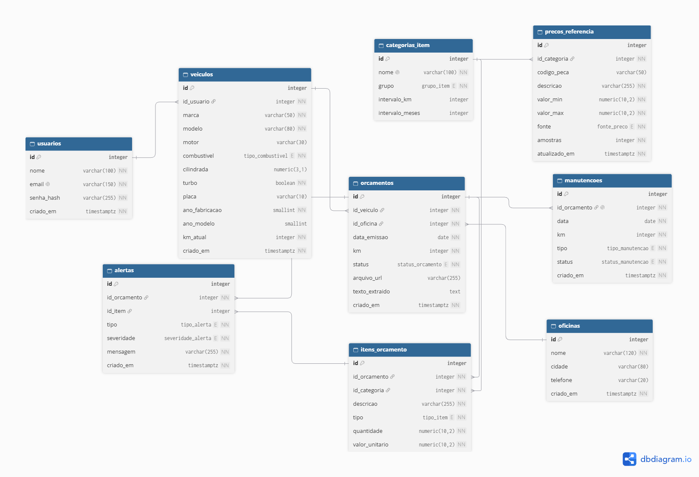

# Revisa

Aplicativo para registrar manutenções de veículos e **analisar orçamentos de oficina**: extrai os itens do orçamento, compara preços com o histórico e sinaliza cobranças suspeitas antes de você aprovar o serviço.

> **Status:** em desenvolvimento. A modelagem do banco de dados está concluída; a API tem cadastro de usuário, login com token (JWT), o CRUD de veículos e o registro de orçamentos com itens e total calculado. Cada usuário só enxerga e altera os próprios dados, inclusive os orçamentos, cujo dono vem do veículo. Alertas, aprovação de orçamento e manutenções ainda serão criados.

## O problema

Quem não entende de mecânica não tem como saber se um orçamento está caro, se um item é desnecessário ou se aquela peça já foi trocada há pouco tempo. O Revisa usa o histórico do próprio veículo e uma base de preços de referência para responder a essas perguntas.

## Funcionalidades planejadas

- Cadastro de veículos e histórico de manutenções
- Registro de orçamentos, com itens separados em peça e mão de obra
- Extração automática dos itens a partir de foto ou PDF do orçamento
- Comparação de dois ou mais orçamentos lado a lado
- Orçamento aprovado vira registro de manutenção
- Alertas automáticos na análise do orçamento:

| Alerta | Quando dispara |
|---|---|
| `TROCA_RECENTE` | A mesma categoria foi trocada há poucos km ou meses |
| `PRECO_ACIMA_MEDIA` | Valor acima da faixa de referência ou de um orçamento concorrente |
| `MAO_OBRA_ALTA` | Mão de obra desproporcional ao total |
| `ITEM_DUPLICADO` | Mesmo item lançado mais de uma vez |
| `ITEM_GENERICO` | Descrição vaga, sem discriminação do que será feito |
| `CONSUMIVEL_CARO` | Consumíveis (estopa, graxa, etc.) acima do esperado |
| `VALOR_ZERADO` | Item sem valor, que pode virar cobrança depois |

## Modelo de dados



| Tabela | Função |
|---|---|
| `usuarios` | Donos dos veículos |
| `veiculos` | Veículos de cada usuário |
| `oficinas` | Oficinas que emitem os orçamentos |
| `orcamentos` | Orçamento de uma oficina para um veículo |
| `itens_orcamento` | Cada linha do orçamento (peça ou mão de obra) |
| `categorias_item` | Catálogo que padroniza os itens e guarda os intervalos de troca |
| `precos_referencia` | Faixa de preço (mínimo e máximo) esperada por categoria |
| `alertas` | Avisos gerados na análise de um orçamento |
| `manutencoes` | Serviço realizado a partir de um orçamento aprovado |

### Decisões de modelagem

- **Itens categorizados:** oficinas escrevem o mesmo item de formas diferentes. A tabela `categorias_item` padroniza os itens e permite comparar preços e detectar trocas recentes.
- **Total não armazenado:** o valor do orçamento é calculado pela soma dos itens, o que evita divergência entre o total e os itens.
- **Uma manutenção por orçamento:** a chave estrangeira `manutencoes.id_orcamento` é única.
- **Quilometragem no orçamento e na manutenção:** registra o km no momento do serviço, base dos alertas de troca recente.
- **Preço de referência em faixa:** `precos_referencia` guarda mínimo e máximo, com a origem do dado (manual, histórico ou externo).
- **Motorização padronizada:** em vez de um texto livre como "1.0 Turbo" (que poderia ser escrito "1.0T" ou "1.0 TSI"), o veículo tem `combustivel` (tipo `tipo_combustivel`: FLEX, GASOLINA, ETANOL, DIESEL, ELETRICO, HIBRIDO), `cilindrada` e `turbo`, que permitem comparar veículos e preços. O campo `motor` virou uma descrição complementar opcional. Só o combustível é obrigatório, porque nem todo dono sabe a cilindrada; `turbo` assume `false` quando não informado.
- **Regras no banco:** restrições `CHECK` impedem quilometragem negativa, quantidade zerada, faixa de preço invertida, cilindrada zero ou negativa e cilindrada em veículo elétrico (a regra `ck_veiculos_combustivel_cilindrada`; o híbrido tem cilindrada).

## Tecnologias

| Camada | Tecnologia |
|---|---|
| Banco de dados | PostgreSQL |
| Back-end | Python, FastAPI, SQLAlchemy, Alembic |
| Segurança | argon2 (hash de senha), PyJWT (token), email-validator |
| Testes | scripts de teste manuais; pytest planejado |
| Infraestrutura | Docker, GitHub Actions (planejados) |

## Como rodar o banco

Pré-requisito: PostgreSQL 14 ou superior.

```bash
createdb revisa
psql -d revisa -f database/schema.sql
psql -d revisa -f database/seed.sql
psql -d revisa -f database/queries.sql
```

Os arquivos devem ser executados nessa ordem. Também é possível abri-los em um cliente como o DBeaver.

O `queries.sql` traz as consultas usadas para validar o modelo, cada uma com o resultado esperado em comentário.

## Como rodar a API

> Em construção: cadastro, login, CRUD de veículos, orçamentos e itens estão prontos; aprovação de orçamento, alertas e manutenções ainda serão criados.

Pré-requisitos: Python 3.10 ou superior e o banco criado conforme a seção anterior.

```bash
python -m venv .venv
.venv\Scripts\activate          # Windows
source .venv/bin/activate       # Linux e macOS
pip install -r requirements.txt
```

A conexão com o banco e o segredo do token são lidos de variáveis de ambiente, nunca escritos no código. Copie o modelo e preencha:

```bash
cp .env.example .env            # Windows: copy .env.example .env
```

| Variável | O que é |
|---|---|
| `DATABASE_URL` | Endereço do PostgreSQL, com usuário e senha |
| `JWT_SECRET` | Segredo que assina os tokens. Mínimo de 32 caracteres |

Para gerar um `JWT_SECRET` forte:

```bash
python -c "import secrets; print(secrets.token_hex(32))"
```

O `.env` está no `.gitignore`, então senha e segredo não vão para o repositório. Se uma variável estiver faltando (ou o `JWT_SECRET` for curto demais), a API para na inicialização com uma mensagem que cita apenas o nome da variável, sem expor o valor.

Para testar a conexão e subir o servidor:

```bash
python api/database.py          # deve imprimir: Conexão bem-sucedida! O banco respondeu: 1
alembic stamp head              # só na primeira vez: registra a versão do banco (ver abaixo)
uvicorn api.main:app --reload
```

**Usuários do seed:** o `seed.sql` traz usuários de exemplo com um hash de senha **inválido de propósito** (o repositório não publica credenciais). Eles existem para ser donos dos veículos de exemplo, mas **não fazem login**. Para testar a API, cadastre um usuário novo em `POST /usuarios`.

### Migrações do banco (Alembic)

As mudanças na estrutura do banco passam a ser feitas por migrações do Alembic, guardadas em `alembic/versions/` e aplicadas em ordem. O banco é criado pelo `schema.sql` e pelo `seed.sql`; a primeira migração (`162a0455a943`, "base: banco existente") está vazia e representa esse ponto de partida. Em um banco recém-criado pelo `schema.sql`, que já está na estrutura final, o comando é `alembic stamp head`, que apenas registra a versão na tabela `alembic_version`, sem executar nada:

```bash
alembic stamp head              # banco criado pelo schema.sql: registra a versão atual
alembic current                 # mostra a versão atual: 33cb4c40f5a3 (head)
alembic upgrade head            # banco existente: aplica as migrações que faltam
```

| Migração | O que faz |
|---|---|
| `162a0455a943` | Base: representa o banco criado pelo `schema.sql`, sem executar nada |
| `33cb4c40f5a3` | Torna `veiculos.ano_modelo` obrigatório (`NOT NULL`); o `downgrade` volta a aceitar vazio |

O `schema.sql` é mantido igual ao resultado das migrações: um banco criado do zero recebe `stamp head` e já fica na versão mais recente, enquanto um banco existente recebe `upgrade head`. Toda migração é testada antes em uma cópia do banco (`CREATE DATABASE bdrevisa_teste TEMPLATE bdrevisa_pd`), subindo, descendo e subindo de novo.

O `alembic/env.py` lê a conexão da mesma `DATABASE_URL` do `.env` usada pela API, então o `alembic.ini` continua só com o endereço de exemplo e nenhuma senha vai para o repositório.

**Atenção:** o model descreve `usuarios`, `veiculos`, `oficinas`, `categorias_item`, `orcamentos` e `itens_orcamento`, mas ainda não `precos_referencia`, `alertas` e `manutencoes`. Por isso o `alembic revision --autogenerate` hoje propõe apagar essas três tabelas. Migrações geradas automaticamente precisam sempre ser revisadas antes de rodar.

Com o servidor rodando, a documentação interativa da API fica em `http://127.0.0.1:8000/docs`.

| Rota | Autenticação | Descrição |
|---|---|---|
| `GET /` | não | Verifica se a API está no ar |
| `POST /usuarios` | não | Cadastra um usuário (201) |
| `POST /login` | não | Troca e-mail e senha por um token (200) |
| `GET /veiculos/{veiculo_id}` | **token** | Busca um veículo do usuário logado pelo identificador |
| `GET /veiculos/placa/{veiculo_placa}` | **token** | Busca veículos do usuário logado pela placa (até 10 caracteres; aceita minúsculas e espaços nas pontas) |
| `POST /veiculos` | **token** | Cadastra um veículo para o usuário logado (201) |
| `PATCH /veiculos/{veiculo_id}` | **token** | Altera só os campos enviados (200) |
| `DELETE /veiculos/{veiculo_id}` | **token** | Apaga um veículo (204); 409 se tiver orçamentos |
| `POST /veiculos/{veiculo_id}/orcamentos` | **token** | Registra um orçamento no veículo do usuário logado; nasce `PENDENTE` (201) |
| `GET /veiculos/{veiculo_id}/orcamentos/{orcamento_id}` | **token** | Devolve o orçamento com os itens, o subtotal de cada um e o total (200) |
| `POST /veiculos/{veiculo_id}/orcamentos/{orcamento_id}/itens` | **token** | Acrescenta um item a um orçamento `PENDENTE` (201); 409 se o orçamento não estiver pendente |

O token vai no cabeçalho `Authorization: Bearer <token>`. No `/docs`, o botão **Authorize** faz isso.

### Cadastro e login

Fluxo: `POST /usuarios` cria a conta, `POST /login` devolve um token, e as rotas de veículos exigem esse token.

Exemplo de `POST /usuarios`:

```json
{"nome": "Maria Souza", "email": "maria@email.com", "senha": "senhaSegura123"}
```

Resposta (201), sem a senha e sem o hash:

```json
{"id": 9, "nome": "Maria Souza", "email": "maria@email.com"}
```

Exemplo de `POST /login` e a resposta (200):

```json
{"email": "maria@email.com", "senha": "senhaSegura123"}
```

```json
{"access_token": "<token JWT>", "token_type": "bearer"}
```

Respostas observadas:

| Requisição | Status | Resultado |
|---|---|---|
| `POST /usuarios` válido | 201 | usuário criado; e-mail gravado em minúsculas e sem espaços nas pontas |
| `POST /usuarios` com e-mail já cadastrado | 409 | `E-mail já cadastrado.` |
| `POST /usuarios` com senha de 7 caracteres, e-mail inválido ou campo extra | 422 | erro de validação |
| `POST /login` correto | 200 | token |
| `POST /login` com e-mail em maiúsculas | 200 | o e-mail é normalizado igual ao cadastro |
| `POST /login` com senha errada | 401 | `E-mail ou senha incorretos.` |
| `POST /login` com e-mail inexistente | 401 | **a mesma** resposta, com o mesmo status e a mesma mensagem |
| `POST /login` com senha de 129 caracteres ou campo extra | 422 | erro de validação |
| Rota de veículo sem token | 401 | `Not authenticated` |
| Rota de veículo com token inválido, adulterado ou expirado | 401 | `Token inválido.` |
| Veículo de outro usuário (leitura, alteração ou exclusão) | 404 | `Veículo não encontrado.`, idêntico ao de um veículo que não existe |

Decisões:

- **Senha nunca é guardada:** o banco guarda só o hash **argon2id** (com salt, lento de propósito). A resposta nunca devolve a senha nem o hash. `argon2.verify` levanta exceção quando a senha não confere; ela é tratada e vira `False`.
- **Mensagem única no login:** e-mail inexistente e senha errada devolvem o mesmo 401 com a mesma mensagem, para o atacante não descobrir quais e-mails existem.
- **Tempo igual nos dois casos:** com e-mail inexistente, a API confere a senha contra um hash falso (argon2 de verdade, gerado uma vez na inicialização), então a resposta leva o mesmo tempo. Medido: 0,063 s com senha errada contra 0,060 s com e-mail inexistente.
- **Cadastro revela e-mail repetido (409):** decisão de produto, porque o usuário precisa saber que já tem conta. O custo é que um atacante pode testar quais e-mails existem pelo cadastro; a mitigação (limite de tentativas) está nas limitações.
- **POST para o login:** as credenciais vão no corpo, e não na URL, que fica registrada em logs.
- **Token JWT (HS256, 30 minutos):** o `sub` é o id do usuário em texto, o `exp` é obrigatório e a leitura só aceita o algoritmo esperado (bloqueia o ataque `alg: none`). O segredo vem do `.env`.
- **Dependência `usuario_atual`:** lê o token, valida, e **consulta o banco** para confirmar que o usuário ainda existe. Se o usuário foi apagado, o token deixa de valer na hora. Token ausente, adulterado, expirado, sem `exp`, com outro segredo, com `sub` que não é número ou de usuário apagado: todos devolvem o mesmo 401.
- **Dono do veículo vem do token:** `id_usuario` não existe mais no corpo (enviá-lo dá 422). Toda consulta de veículo filtra pelo dono **dentro do `WHERE`**, então o veículo alheio simplesmente não existe para quem pergunta. O erro é 404 e não 403, para não confirmar que o veículo existe.

### Como a API acessa o banco

As rotas não escrevem SQL à mão. Cada peça tem um papel:

| Arquivo | Papel |
|---|---|
| `api/database.py` | Cria a conexão (`engine`) a partir da `DATABASE_URL` |
| `api/config.py` | Lê o `JWT_SECRET` do `.env` e valida o tamanho; define algoritmo e expiração do token |
| `api/seguranca.py` | Hash e verificação de senha (argon2) e criação e leitura do token (JWT) |
| `api/enums.py` | Valores aceitos, compartilhados pelo model e pelo schema: `TipoCombustivelEnum`, `GrupoItemEnum`, `StatusOrcamentoEnum` e `TipoItemEnum` |
| `api/regras.py` | Regras de negócio puras, usadas pelo schema e pela rota: `ano_valido`, `combustivel_valido`, `emissao_valida`, `calcular_subtotal` e `calcular_total` |
| `api/models.py` | Models `Usuario`, `Veiculo`, `Oficina`, `CategoriaItem`, `Orcamento` e `ItemOrcamento` (SQLAlchemy): as tabelas descritas em Python, inclusive colunas internas e pessoais |
| `api/schemas.py` | Schemas Pydantic: entrada (`VeiculoCriar`, `VeiculoAtualizar`, `UsuarioCriar`, `LoginEntrada`, `OrcamentoCriar`, `ItemOrcamentoCriar`) e resposta (`VeiculoResposta`, `UsuarioResposta`, `TokenResposta`, `OrcamentoResposta`, `OrcamentoDetalheResposta`, `ItemOrcamentoResposta`) |
| `api/main.py` | Rotas e a dependência `usuario_atual` |

```
banco → model → rota → schema de resposta → JSON
```

O model tem `placa`, `id_usuario` e `senha_hash` porque representa a tabela; o schema de resposta não tem, então esses campos são descartados antes da resposta, mesmo que a consulta os traga.

Segurança das consultas:

- **Validação de entrada:** a placa é limitada a 10 caracteres com `Path(max_length=10)`. Uma entrada maior recebe 422 antes de qualquer acesso ao banco.
- **Parâmetros automáticos:** as consultas são montadas com `select(...).where(...)`, e o SQLAlchemy envia os valores como parâmetros, separados do comando, o que impede SQL Injection.
- **Lista branca na resposta:** o `response_model` só deixa sair os campos do schema. Dados internos (`id_usuario`, `senha_hash`) e pessoais (`placa`) nunca chegam ao cliente.
- **Erros genéricos:** a resposta de erro não revela detalhes do banco; o motivo de uma falha aparece apenas no terminal do servidor.

As camadas são complementares (defesa em profundidade): o limite de tamanho barra entradas absurdas, mas não é a proteção contra SQL Injection. Um ataque curto como `'OR 1=1--` cabe em 10 caracteres e chega ao banco, onde o parâmetro o transforma em uma busca inofensiva (404).

Respostas de `GET /veiculos/{veiculo_id}` (com o token do dono do veículo e os dados do `seed.sql`):

| Requisição | Status | Resposta |
|---|---|---|
| `/veiculos/1` | 200 | `{"id":1,"marca":"Volkswagen","modelo":"Gol","motor":"MPI","combustivel":"FLEX","cilindrada":"1.0","turbo":false,"ano_fabricacao":2018,"ano_modelo":2018,"km_atual":98000}` |
| `/veiculos/7` | 200 | `{"id":7,"marca":"BYD","modelo":"Dolphin","motor":null,"combustivel":"ELETRICO","cilindrada":null,"turbo":false,"ano_fabricacao":2024,"ano_modelo":2024,"km_atual":15000}` |
| `/veiculos/99999` | 404 | `{"detail":"Veículo não encontrado."}` |
| `/veiculos/1` com o token de **outro** usuário | 404 | a mesma resposta acima |
| `/veiculos/abc` | 422 | Erro de validação: o identificador precisa ser um número inteiro |

Respostas de `GET /veiculos/placa/{veiculo_placa}` (com o token do dono):

| Requisição | Status | Resposta |
|---|---|---|
| `/veiculos/placa/QWE1A23` | 200 | `[{"id":1,"marca":"Volkswagen","modelo":"Gol","motor":"MPI","combustivel":"FLEX","cilindrada":"1.0","turbo":false,"ano_fabricacao":2018,"ano_modelo":2018,"km_atual":98000}]` |
| `/veiculos/placa/qwe1a23` | 200 | Mesmo resultado: a placa é normalizada com `strip().upper()` antes da consulta |
| `/veiculos/placa/AAA0000` | 404 | `{"detail":"Veículo não encontrado."}` |
| `/veiculos/placa/AAAAAAAAAAA` | 422 | Erro de validação `string_too_long`: a placa tem no máximo 10 caracteres, igual ao `varchar(10)` do banco |

Como a placa não é única no banco, a rota devolve uma lista.

Sobre os campos da resposta:

- `combustivel` só assume um dos seis valores do enum, que aparecem documentados em `/docs`.
- `cilindrada` vem como texto (`"1.0"`), e não como número. Ela é um `Decimal`, e o JSON transformaria um número em ponto flutuante no cliente, com risco de perder precisão; como texto, o valor chega exato. É `null` em veículos elétricos.

### Cadastro, alteração e exclusão de veículos

Com a escrita, o cliente passa a mandar dados para o banco. Por isso a entrada tem schemas próprios, separados do de resposta:

| Schema | Uso | Regras |
|---|---|---|
| `VeiculoCriar` | corpo do `POST` | todos os campos obrigatórios do banco exigidos; `extra = 'forbid'` |
| `VeiculoAtualizar` | corpo do `PATCH` | todos os campos opcionais (padrão `None`); `extra = 'forbid'` |
| `VeiculoResposta` | resposta das rotas | lista branca: sem `placa`, `id_usuario` e `criado_em` |

Exemplo de `POST /veiculos` (com o cabeçalho `Authorization`):

```json
{"marca": "Fiat", "modelo": "Argo", "motor": "Firefly", "placa": " abc1d23 ",
 "combustivel": "FLEX", "cilindrada": "1.3", "turbo": false,
 "ano_fabricacao": 2021, "ano_modelo": 2022, "km_atual": 30000}
```

Resposta (201), com `id` gerado pelo banco e sem `placa`:

```json
{"id": 9, "marca": "Fiat", "modelo": "Argo", "motor": "Firefly", "combustivel": "FLEX", "cilindrada": "1.3", "turbo": false, "ano_fabricacao": 2021, "ano_modelo": 2022, "km_atual": 30000}
```

Respostas observadas:

| Requisição | Status | Resultado |
|---|---|---|
| `POST` válido | 201 | veículo criado para o usuário logado; placa gravada como `ABC1D23` (`strip().upper()`) |
| `POST` sem token | 401 | `Not authenticated` |
| `POST` com `id`, `id_usuario` ou `criado_em` | 422 | `extra_forbidden` (mass assignment barrado) |
| `POST` com `km_atual: -1` | 422 | `greater_than_equal` |
| `POST` elétrico com cilindrada | 422 | "Veículo elétrico não tem cilindrada." |
| `POST` com `ano_fabricacao 2022` e `ano_modelo 2024` | 422 | o ano do modelo é igual ao de fabricação ou no máximo 1 a mais |
| `PATCH {"km_atual": 105000}` | 200 | só o km muda |
| `PATCH {}` | 200 | nada muda |
| `PATCH {"marca": null}` | 422 | campo obrigatório no banco não aceita `null` |
| `PATCH {"motor": null}` / `{"cilindrada": null}` | 200 | campos opcionais aceitam `null` |
| `PATCH {"combustivel": "ELETRICO"}` em veículo com cilindrada | 422 | "Veículo elétrico não tem cilindrada." |
| `PATCH {"ano_modelo": 2025}` em veículo de 2018 | 422 | regra dos anos checada sobre os valores finais; nada é gravado |
| `PATCH {"id_usuario": 5}` | 422 | o dono não muda por PATCH |
| `PATCH` ou `DELETE` em id inexistente ou de outro usuário | 404 | `Veículo não encontrado.` |
| `DELETE` de veículo sem orçamentos | 204 | apagado; o `GET` seguinte dá 404 |
| `DELETE /veiculos/1` pelo dono (tem orçamentos) | 409 | `Veículo possui orçamentos vinculados. Não é possível apagar o veículo.` |

Decisões:

- **Entrada separada da resposta:** o cliente não escolhe `id`, `id_usuario` nem `criado_em`. O `id_usuario` vem do token.
- **`forbid` na entrada:** campo desconhecido gera erro 422 em vez de ser ignorado em silêncio. O `forbid` só vale onde chega dado de fora; a resposta é montada pelo servidor.
- **`PATCH` com `exclude_unset=True`:** aplica só o que o cliente enviou. O padrão `None` do schema nunca chega ao banco. Campos obrigatórios no banco recusam `null` enviado, mas podem ser omitidos.
- **Regras entre campos em um lugar só:** a regra dos anos e a do elétrico sem cilindrada ficam em `api/regras.py`. O schema (`POST`) e a rota (`PATCH`, sobre os valores finais do veículo, porque o schema só enxerga o corpo) chamam as mesmas funções.
- **Limites espelham as colunas:** além dos mínimos, o schema impõe máximos (`km_atual` até 6.000.000; `cilindrada` com `max_digits=3`, `decimal_places=1`, sem infinito nem `NaN`; textos com o tamanho do `varchar`), para o erro do cliente virar 422 e não 500.
- **Placa normalizada na gravação:** `strip().upper()`, igual à busca. Aceita `null`, e a placa não é única.
- **Erros do banco:** `IntegrityError` no `commit` gera `rollback` e resposta genérica (422 no cadastro e na alteração, 409 na exclusão). O detalhe vai só para o terminal.
- **Exclusão bloqueada com vínculos:** a chave estrangeira não tem `ON DELETE`, então o banco impede apagar veículo com orçamentos. Foi mantido assim de propósito para não destruir histórico.

### Orçamentos e itens

O orçamento não tem `id_usuario`: o dono vem do veículo (`orçamento → veículo → usuário`). Por isso toda consulta de orçamento junta as duas tabelas e confere o dono **dentro do `WHERE`**, com três condições juntas: o id do orçamento, o id do veículo da URL e o dono do veículo.

```
token → id do usuário → o orçamento existe, é do veículo da URL e o veículo é do usuário? → só então lê ou grava
```

| Schema | Uso | Regras |
|---|---|---|
| `OrcamentoCriar` | corpo do `POST` de orçamento | `id_oficina` > 0; `data_emissao` não pode ser futura; `km` de 0 a 6.000.000; `extra = 'forbid'` |
| `ItemOrcamentoCriar` | corpo do `POST` de item | `descricao` de 1 a 255 caracteres (sem espaços nas pontas); `quantidade` > 0; `valor_unitario` ≥ 0; ambos até 10 dígitos com 2 decimais, sem infinito nem `NaN`; `extra = 'forbid'` |
| `OrcamentoResposta` | resposta do `POST` de orçamento | lista branca: sem `criado_em`, `arquivo_url` e `texto_extraido` |
| `ItemOrcamentoResposta` | cada item nas respostas | inclui o `subtotal`; sem `id_orcamento` |
| `OrcamentoDetalheResposta` | resposta do `GET` | o orçamento, mais `itens` e `total` |

Exemplo de `POST /veiculos/9/orcamentos` (com o cabeçalho `Authorization`):

```json
{"id_oficina": 1, "data_emissao": "2026-10-20", "km": 31000}
```

Resposta (201): o status nasce `PENDENTE` e não é escolhido pelo cliente.

```json
{"id": 15, "id_veiculo": 9, "id_oficina": 1, "data_emissao": "2026-10-20", "km": 31000, "status": "PENDENTE"}
```

Exemplo de `POST /veiculos/9/orcamentos/15/itens`:

```json
{"id_categoria": 10, "descricao": "Pastilha de freio dianteira", "tipo": "PECA", "quantidade": "2.00", "valor_unitario": "10.50"}
```

Resposta (201), com o subtotal calculado pelo servidor:

```json
{"id": 62, "id_categoria": 10, "descricao": "Pastilha de freio dianteira", "tipo": "PECA", "quantidade": "2.00", "valor_unitario": "10.50", "subtotal": "21.00"}
```

Resposta de `GET /veiculos/1/orcamentos/3` (com o token do dono do veículo e os dados do `seed.sql`; o orçamento tem a bomba d'água lançada duas vezes):

```json
{
  "id": 3, "id_veiculo": 1, "id_oficina": 3, "data_emissao": "2026-09-20", "km": 97900, "status": "RECUSADO",
  "itens": [
    {"id": 10, "id_categoria": 13, "descricao": "Kit correia dentada + tensor", "tipo": "PECA", "quantidade": "1.00", "valor_unitario": "690.00", "subtotal": "690.00"},
    {"id": 11, "id_categoria": 17, "descricao": "Bomba d'água", "tipo": "PECA", "quantidade": "1.00", "valor_unitario": "380.00", "subtotal": "380.00"},
    {"id": 12, "id_categoria": 17, "descricao": "Bomba d'água", "tipo": "PECA", "quantidade": "1.00", "valor_unitario": "380.00", "subtotal": "380.00"},
    {"id": 13, "id_categoria": 29, "descricao": "Material diverso", "tipo": "PECA", "quantidade": "1.00", "valor_unitario": "150.00", "subtotal": "150.00"},
    {"id": 14, "id_categoria": 4, "descricao": "Líquido de arrefecimento (litro)", "tipo": "PECA", "quantidade": "3.00", "valor_unitario": "32.00", "subtotal": "96.00"},
    {"id": 15, "id_categoria": 28, "descricao": "Mão de obra correia e bomba d'água", "tipo": "MAO_OBRA", "quantidade": "1.00", "valor_unitario": "450.00", "subtotal": "450.00"}
  ],
  "total": "2146.00"
}
```

Respostas observadas:

| Requisição | Status | Resultado |
|---|---|---|
| `POST` de orçamento válido | 201 | orçamento criado com `status` `PENDENTE`, sem `criado_em` |
| `POST` de orçamento com `km` menor que o `km_atual` do veículo | 201 | permitido: um orçamento antigo é legítimo |
| `POST` de orçamento sem token | 401 | `Not authenticated` |
| `POST` de orçamento em veículo de outro usuário ou inexistente | 404 | `Veículo não encontrado.`, nada é gravado |
| `POST` de orçamento com `id`, `id_veiculo`, `status` ou `criado_em` | 422 | `extra_forbidden` (mass assignment barrado) |
| `POST` de orçamento com `id_oficina` inexistente | 422 | `Oficina inválida.` |
| `POST` de orçamento com `km` negativo ou enorme, data futura ou data inválida | 422 | erro de validação |
| `GET` do orçamento pelo dono | 200 | orçamento, itens, subtotais e total |
| `GET` sem token | 401 | `Not authenticated` |
| `GET` por outro usuário, com o veículo do dono | 404 | `Orçamento não encontrado.` |
| `GET` por outro usuário, com **o próprio veículo** e o orçamento do dono | 404 | a mesma resposta |
| `GET` pelo dono com um veículo dele que não é o do orçamento | 404 | a mesma resposta |
| `GET` de ids inexistentes | 404 | a mesma resposta, idêntica nos quatro casos |
| `GET` com `orcamento_id` não numérico | 422 | erro de validação |
| `POST` de item válido | 201 | item criado, com `subtotal` |
| `POST` de item em orçamento alheio, com veículo alheio ou que não combina | 404 | `Orçamento não encontrado.`, nada é gravado |
| `POST` de item em orçamento `APROVADO` ou `RECUSADO` | 409 | `Não é possível alterar este orçamento.` |
| `POST` de item com `id_categoria` inexistente | 422 | `Categoria inválida.` |
| `POST` de item com `id`, `id_orcamento` ou `subtotal` | 422 | `extra_forbidden` |
| `POST` de item com `descricao` vazia, só com espaços ou com 256 caracteres | 422 | erro de validação |
| `POST` de item com `quantidade` 0, negativa, `inf` ou `NaN` | 422 | erro de validação |
| `POST` de item com `valor_unitario` negativo ou com 11 dígitos | 422 | erro de validação |
| `POST` de item com `valor_unitario` 0 | 201 | permitido: o banco aceita e o alerta `VALOR_ZERADO` existe para esse caso |

Decisões:

- **Dono pela junção, no `WHERE`:** o orçamento alheio simplesmente não existe para quem pergunta. O erro é 404 e não 403, para não confirmar que ele existe.
- **Os dois ids da URL precisam casar:** um usuário que passa o **próprio** `veiculo_id` com o `orcamento_id` de outro também recebe 404. Checar só o veículo abriria essa brecha.
- **Mesma resposta nos quatro 404:** orçamento alheio, veículo alheio, ids que não combinam e ids inexistentes devolvem o mesmo status e o mesmo corpo.
- **Ids vêm do objeto validado:** `id_veiculo` e `id_orcamento` gravados são os do veículo e do orçamento que a consulta devolveu, nunca o texto da URL e nunca o corpo.
- **Status não é escolhido pelo cliente:** o orçamento nasce `PENDENTE`. Item só entra em orçamento `PENDENTE`, para o total não mudar depois da decisão do dono (409 com conflito de estado).
- **Total e subtotal calculados pelo servidor:** funções puras em `api/regras.py` (`calcular_subtotal`, `calcular_total`), sem acesso ao banco. O cliente não tem como mandar um total. Os valores usam `Decimal` e saem como texto no JSON (`"2146.00"`).
- **Arredondamento por item:** cada subtotal é arredondado para 2 casas e o total é a soma deles (padrão `ROUND_HALF_EVEN` do Python; ver limitações).
- **`km` menor que o do veículo é permitido,** e a data de emissão não pode ser futura (`emissao_valida`).
- **Oficinas e categorias são um catálogo compartilhado,** sem dono. O cliente só escolhe por id. A existência é conferida antes de gravar (422 limpo), e o `IntegrityError` no `commit` continua como rede de segurança.
- **Limites espelham as colunas:** `descricao` até 255, `quantidade` e `valor_unitario` em `numeric(10,2)`, para o erro do cliente virar 422 e não 500.

### Bateria de segurança

Rodada em banco de testes (`bdrevisa_teste`), com a API no ar. Todos os casos passaram.

**CRUD de veículos** (`exercicios/testa_schema.py --api`, já autenticado):

| Ataque | Resultado |
|---|---|
| S1: `POST` com `id`, `id_usuario` ou `criado_em` | 422 `extra_forbidden` |
| S2: `POST` com `marca = '; DROP TABLE veiculos;--` | 201, texto gravado igual ao enviado; a tabela segue intacta |
| S3: `PATCH` com placa `' OR '1'='1` (11 caracteres) | 422 `string_too_long` |
| S3: `PATCH` com placa `'OR 1=1--` (9 caracteres) e busca por ela | 200; a busca devolve só o veículo alterado |
| S4: `marca` e `modelo` com 10.000 caracteres | 422 `string_too_long` |
| S5: cilindrada `"inf"` e `"NaN"` | 422 `finite_number` |
| S5: `turbo = "talvez"` | 422 `bool_parsing` |
| S5: cilindrada `100` | 422 `decimal_whole_digits` |
| S5: `km_atual = 99999999999` | 422 `less_than_equal` |
| S6: respostas de `POST` e `PATCH` | sem `placa`, `id_usuario` e `criado_em` |

**Login e token** (`testa_login.py` e a `usuario_atual`):

| Ataque | Resultado |
|---|---|
| Senha errada × e-mail inexistente | 401 com a mesma mensagem; tempo médio 0,063 s × 0,060 s |
| Usuário do seed (hash inválido no banco) | 401, nunca 500 |
| Senha de 129 caracteres, campo extra | 422 |
| Sem token, texto qualquer no lugar do token | 401 |
| Token com um caractere trocado (adulterado) | 401 |
| Token expirado | 401 |
| Token assinado com outro segredo | 401 |
| Token `alg: none` (sem assinatura) | 401 |
| Token sem `exp` | 401 |
| Token com `sub` que não é número | 401 (não 500) |
| Token válido de usuário apagado | 401 |

**Posse dos dados, com dois usuários** (`testa_posse.py`):

| Ataque | Resultado |
|---|---|
| Criar veículo sem token ou com token falso | 401 |
| Dono gravado | é o do token (e muda de um usuário para outro) |
| Outro usuário lê por id ou por placa | 404, idêntico ao de veículo inexistente |
| Outro usuário altera | 404, e o veículo não muda |
| `PATCH` com `id_usuario` de outro | 422; o dono não muda |
| Outro usuário apaga | 404, e o veículo continua existindo |
| `PATCH` e `DELETE` sem token | 401 |

**Com os dados do seed** (`testa_seed.py`, usuários de exemplo com senha local): os três usuários logam; só o dono vê o veículo 1; o dono recebe 409 ao apagar (tem orçamentos); os outros dois recebem 404.

**Orçamentos e itens, com dois usuários** (`testa_orcamento.py`, `testa_orcamento_get.py` e `testa_item_criar.py`):

| Ataque | Resultado |
|---|---|
| Criar orçamento no veículo de outro usuário | 404, e a contagem de orçamentos do veículo não muda |
| Veículo inexistente × veículo alheio | 404 com o mesmo corpo |
| `id`, `id_veiculo`, `status` ou `criado_em` no corpo do orçamento | 422 `extra_forbidden`, um campo por vez |
| `id_oficina` inexistente | 422, nunca 500 |
| `km` negativo, `km` com 11 dígitos, data futura, data `abc` | 422 |
| Ler o orçamento de outro usuário com o veículo do dono | 404 |
| **Ler o orçamento do dono com o próprio veículo** (IDOR aninhado) | 404 |
| Ler o orçamento de um veículo com o `veiculo_id` de outro veículo do mesmo dono | 404 |
| Os quatro 404 da leitura | corpos idênticos |
| Resposta da leitura | sem `criado_em`, `arquivo_url` e `texto_extraido`; `total` como texto |
| Orçamento 3 do seed pelo dono | 200, 6 itens, total `"2146.00"` |
| Criar item em orçamento alheio, com veículo alheio ou que não combina | 404, e a contagem de itens não muda |
| `id`, `id_orcamento` ou `subtotal` no corpo do item | 422 `extra_forbidden`, um campo por vez |
| `id_categoria` inexistente | 422, nunca 500 |
| `descricao` vazia, só com espaços ou com 256 caracteres | 422 |
| `quantidade` 0, negativa, `inf` ou `NaN` | 422 |
| `valor_unitario` negativo ou com 11 dígitos | 422 |
| Item em orçamento `RECUSADO` | 409, e nada é gravado |
| Item novo e `GET` seguinte | o total é recalculado pelo servidor |

### Limitações conhecidas

| Limitação | Detalhe | Quando resolver |
|---|---|---|
| Sem limite de tentativas | login e cadastro aceitam tentativas ilimitadas (força bruta e teste de e-mails existentes) | S6 |
| Token sem revogação | o token vale até expirar (30 min); não há logout nem refresh token. Usuário apagado é barrado na hora | futuro |
| Senha só com espaços | uma senha de 8 espaços é aceita | revisar |
| JSON com `Infinity` cru | corpo com a palavra `Infinity` (JSON inválido) devolve 500 em vez de 422: o erro estoura ao montar a própria resposta 422, que tenta devolver o valor recebido | investigar |
| `print(e)` nos erros do banco | em produção deve ser log (e o `print` mostraria parâmetros da consulta) | S6 (`logging`) |
| Mensagem do 409 do cadastro e do DELETE | supõem a causa sem checar | revisar quando outras tabelas apontarem para `veiculos` |
| Arredondamento do banqueiro | os subtotais usam o padrão `ROUND_HALF_EVEN` do Python: `5.005` vira `5.00`. Pode divergir 1 centavo do valor impresso pela oficina. Decisão do autor: manter | revisar |
| `data_emissao` sem piso | só barra datas futuras; uma data como `0001-01-01` é aceita | revisar |
| Tipo do item × grupo da categoria | nada impede um item `MAO_OBRA` com uma categoria de peça | motor de alertas (S4) |
| Status do orçamento não muda pela API | não há rota para aprovar ou recusar; um orçamento `APROVADO` ou `RECUSADO` fica fechado para novos itens | aprovação (S5) |
| Sem listagem, alteração ou exclusão de orçamentos e itens | só criar e consultar | próximas etapas |
| Oficinas e categorias sem rota de cadastro | o cliente só escolhe entre as que já existem no banco (vêm do `seed.sql`) | quando o produto pedir |
| Testes fora do repositório | os scripts de teste ficam só na máquina do autor | S6: virar pytest |

### Laboratório de SQL Injection

A rota por placa recebe texto livre, por isso foi usada para estudar SQL Injection. Primeiro foi escrita, apenas localmente e sem commit, uma versão vulnerável que montava o SQL colando a placa no texto da consulta (f-string). Depois ela foi corrigida com parâmetro nomeado; hoje a consulta usa o model, que gera o parâmetro automaticamente (`WHERE veiculos.placa = :placa_1`).

| Placa enviada | Versão vulnerável (f-string) | Versão segura (`:placa`) |
|---|---|---|
| `QWE1A23` | 200, só o Gol | 200, só o Gol |
| `' OR '1'='1` | 200, **todos os veículos do banco** | 404 |
| `'` | 500, erro de sintaxe do PostgreSQL | 404 |

Na versão vulnerável, a aspa enviada fecha a aspa do código e o banco recebe `WHERE placa = '' OR '1'='1'`, condição verdadeira para todas as linhas. Com o parâmetro nomeado, o valor é enviado separado do comando e tratado só como dado: o ataque vira a busca por uma placa que não existe. A normalização com `strip().upper()` é só usabilidade; quem protege é o parâmetro.

Com o limite de 10 caracteres adicionado depois, `' OR '1'='1` (11 caracteres) passou a receber 422 antes de chegar ao banco. Os testes com ataques curtos, como `'OR 1=1--`, continuam mostrando a proteção do parâmetro.

## Protótipo em terminal

Antes da API, a lógica de cálculo e de alertas está sendo validada em um programa de terminal, sem banco de dados e sem bibliotecas externas.

O `exercicios/analisador_orcamento.py`:

- cadastra os itens de um orçamento (descrição, tipo, quantidade e valor unitário)
- valida a entrada: recusa texto no lugar de número, valores negativos, infinitos e tipo inexistente, e aceita vírgula como separador decimal
- calcula o total e separa peças de mão de obra, com o percentual de cada um
- gera três dos alertas planejados para a API:

| Alerta | Regra no protótipo |
|---|---|
| Mão de obra alta | Percentual de mão de obra acima do limite informado |
| Item duplicado | Mesma descrição lançada mais de uma vez, sem diferenciar maiúsculas nem espaços nas pontas |
| Valor zerado | Item com valor unitário igual a zero |

As funções de cálculo e de alertas recebem dados e devolvem dados, sem ler o teclado nem imprimir na tela. Assim, a mesma lógica pode ser reaproveitada na API, com os itens vindos do banco. Os valores usam `Decimal`, pelo mesmo motivo do `numeric(10,2)` no banco: evitar erro de arredondamento com dinheiro. Os tipos seguem os códigos do enum `tipo_item` (`PECA` e `MAO_OBRA`).

Para rodar (Python 3.10 ou superior):

```bash
python exercicios/analisador_orcamento.py
```

Exemplo com os itens do orçamento 3 do `seed.sql`, em que a bomba d'água foi lançada duas vezes (limite de mão de obra: 50%):

```
Orçamento total de: R$1900.00
Valor Peça: R$1450.00 (76.32%)
Valor Mão de obra: R$450.00 (23.68%)

ALERTA! Item duplicado: bomba d'água
```

## Estrutura do repositório

```
database/
 ├── schema.sql      estrutura: tipos, tabelas, índices e restrições
 ├── seed.sql        dados iniciais e de teste (fictícios)
 ├── queries.sql     consultas de validação com o resultado esperado
 ├── modelo.dbml     código-fonte do diagrama (dbdiagram.io)
 └── diagrama.png    diagrama do banco

api/
 ├── main.py         aplicação FastAPI, rotas e a dependência usuario_atual
 ├── database.py     conexão com o banco (lê DATABASE_URL do .env)
 ├── config.py       configuração do token (lê JWT_SECRET do .env)
 ├── seguranca.py    hash de senha (argon2) e token (JWT)
 ├── enums.py        enums compartilhados (combustível, grupo, status e tipo de item)
 ├── regras.py       regras de negócio puras (anos, combustível × cilindrada, data de emissão, subtotal e total)
 ├── models.py       models de usuário, veículo, oficina, categoria, orçamento e item (SQLAlchemy), espelho das tabelas
 └── schemas.py      schemas Pydantic de entrada e de resposta

alembic/
 ├── env.py          configuração: lê a DATABASE_URL e o model
 └── versions/       migrações, em ordem

exercicios/
 └── analisador_orcamento.py   protótipo em terminal do cálculo e dos alertas

requirements.txt     dependências Python com as versões fixadas
.env.example         modelo das variáveis de ambiente (copiar para .env)
alembic.ini          configuração do Alembic (sem senha)
```

## Roadmap

- [x] Modelagem do banco de dados
- [x] Protótipo em terminal do cálculo e dos alertas
- [x] API: CRUD de veículos (consultar, cadastrar, alterar, apagar)
- [x] API: cadastro de usuário, login (hash argon2 + JWT) e dono do veículo
- [x] API: orçamentos e itens, com dono pelo veículo e total calculado
- [ ] Aprovar ou recusar orçamento e histórico de manutenções
- [ ] Upload do orçamento e extração automática dos itens
- [ ] Motor de alertas
- [ ] Comparador de orçamentos e aprovação
- [ ] Testes automatizados, CI e deploy

## Autor

Wellington Strehle — projeto pessoal de estudo e portfólio.